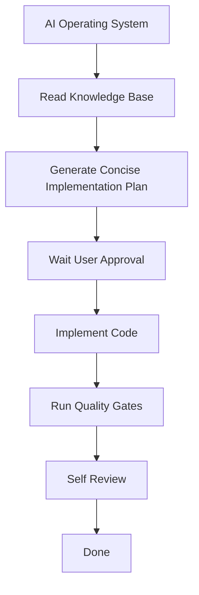

# AI DEVELOPMENT WORKFLOW

This workflow defines the mandatory development process for the Bakery ERP project, optimized for consistency, deterministic output, and minimal token usage.

---

## 1. Flow Diagram

---

## 2. Step 1: AI Operating System
Always read and adhere to [27.ai-operating-system.md](file:///d:/antigravity/erp-bakery/knowledge-base/27.ai-operating-system.md) as the highest-level behavior specification. Do not perform exploratory scans or propose new patterns.

---

## 3. Step 2: Read Knowledge Base
Before writing any code or plans, read the related documentation from `/knowledge-base`.

---

## 4. Step 3: Generate Concise Implementation Plan
Create a short, complete Implementation Plan. Avoid repeating existing repository architecture or long summaries.
The plan must only contain:
- **Objective**
- **Proposed Changes** (list files to create/modify/delete)
- **Repository Migration**
- **Verification Plan**

*Stop and wait for explicit User Approval.*

---

## 5. Step 4: Implement Code
Upon user approval, write clean, production-ready code.
- **Strict Reuse**: Always reuse `ERP` Foundation components from `src/components/erp`.
- **No Direct Shadcn Imports**: Never import Shadcn primitives in page files.
- **No placeholders**: Generate 100% complete files.

---

## 6. Step 5: Run Quality Gates
Before declaring the task done, verify compliance with [22.repository-quality-gates.md](file:///d:/antigravity/erp-bakery/knowledge-base/22.repository-quality-gates.md):
- **Compile check**: Run `npx tsc --noEmit` in both `/frontend` and `/backend`.
- **Component checks**: Ensure no raw inputs/buttons remain and no direct Shadcn imports exist in page files.

---

## 7. Step 6: Self Review
Provide a final verification walkthrough summarizing:
- Components implemented and verified.
- Quality Gates execution status (build compiler checks).

---

## 8. Step 7: Done
Stop and wait for the next user request.