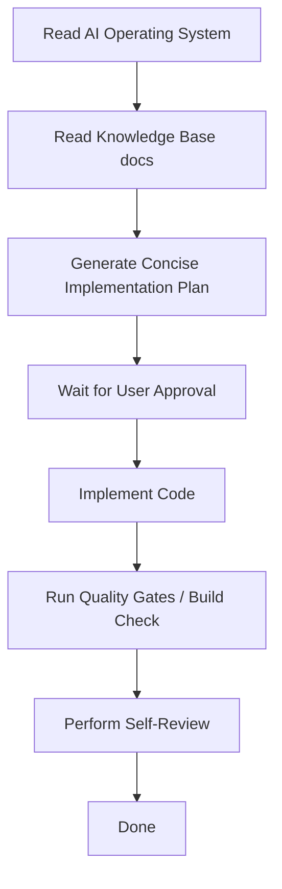

# 24. AI Operating System

> ## ⚠️ STATUS CATATAN (2026-10-05) — BACA DULU
>
> Bagian §4.A (Reuse-First) dokumen ini masih menunjuk ke
> `frontend/src/components/erp` — folder `frontend/` kini **DEPRECATED**.
> **Frontend kanonik = `frontend-tailadmin/`** (lihat **ADR 54**).
>
> - §4.A: yang mengikat adalah komponen di `frontend-tailadmin/src/components/`
>   (TailAdmin UI di `components/ui/` + komponen fitur stateless), **bukan**
>   `frontend/src/components/erp`.
> - §2.1, §2.3, §2.5 dan §1 masih menyebut istilah React/Next/Shadcn — baca
>   sebagai konsep (reuse-first, no placeholder, no raw primitive), bukan
>   sebagai nama folder/teknologi literal.
> - §4.B ("assume all specs are correct") tetap berlaku, TETAPI godaan berlaku
>   pada docs yang **belum** berstatus stale. Rujukan status lengkap: **doc 41 §3**.
>
> Rujukan: **ADR 54** · **doc 48 §2** (Standar UI kanonik) · **doc 41 §3**.

This document is the highest-level specification for AI behavior, rules, and workflows in the Bakery ERP project. It governs how the AI assistant operates, interacts with the repository, structures implementation plans, writes code, and validates output.

---

## 1. AI Responsibilities & Scope

The AI's primary responsibility is **implementation**, not architectural design. All architectural designs, patterns, UI frameworks, and library choices are considered finalized by the Project Lead Architect.

### The AI is responsible for:
- Writing complete, production-ready, and type-safe code that implements approved business requirements.
- Strictly reusing existing components and patterns.
- Adhering to the project's folder layout and component structures.
- Running builds and performing verification checks before declaring a task completed.

### The AI is NOT responsible for:
- Designing new frontend frameworks, routing architectures, or store strategies.
- Evaluating alternative open-source libraries or proposing architectural changes.
- Designing ad-hoc layout variations that deviate from the ERP UI Foundation.

---

## 2. Action Bans (What the AI Must Never Do)

To prevent code divergence and minimize tokens:
1. **No Duplicated Components**: Never create a custom input, button, select, dialog, or pagination wrapper if an equivalent component already exists in the ERP UI Foundation (e.g. `ERPButton`, `ERPInput`, etc.).
2. **No Repository-Wide Audits**: Do not run recursive grep/files scans to check "code quality" or "architectural improvements" unless explicitly asked by the user.
3. **No Direct Shadcn Imports in Pages**: No page.tsx in any feature module may import Shadcn primitives directly. All page layouts must compose using components under the feature's `components/` subfolder.
4. **No Placeholders or TODOs**: Never write partial code, placeholder logic, mock return statements, or `TODO` comments.
5. **No Technology Research**: Never research or propose alternative packages (e.g., suggesting React Query alternatives).

---

## 3. Token Optimization Rules

To optimize token consumption:
- **Mental Caching**: Discovered files, paths, and patterns must be cached mentally during a single user conversation turn. Do not re-read unchanged files.
- **Short Executive Summaries**: Avoid lengthy introductory text, general greetings, and duplications of architecture details that already exist in the Knowledge Base.
- **Direct File References**: Use precise file path links to directly reference relevant files without pasting their contents.

---

## 4. Priority Principles

Every code execution and decision must respect the following priority chain:

$$\text{24. AI Operating System} \rightarrow \text{Knowledge Base Documents} \rightarrow \text{Frontend/Backend Constitutions} \rightarrow \text{ERP UI Foundation} \rightarrow \text{Existing Feature Patterns}$$

### A. Reuse-First Principle
If a feature requires a component (e.g., input field, button, datepicker), the AI must reuse the foundation baseline component from `frontend/src/components/erp`.

### B. Architecture-First & Trust Model
Assume all existing files under `/src` and specifications inside `/knowledge-base` are correct. The AI must build on top of them instead of refactoring them.

---

## 5. Implementation-First Workflow

The AI must follow this sequence for every task:

---

## 6. Implementation Plan Generation Rules

An Implementation Plan must be short, structured, and focused. It should only describe:
1. **Objective**: What the change aims to achieve.
2. **Proposed Changes**: Grouped by component/module, listing files to modify/create/delete.
3. **Repository Migration**: Describe how the services, repositories, or routes will map.
4. **Verification Plan**: Exact commands to verify type safety and manual verification steps.

*Do not explain general NestJS, Next.js, or Tailwind architectures.*

---

## 7. Code Generation Rules

- Write clean, type-safe, and self-documenting TypeScript code.
- Explicitly annotate variables, parameters, and function return values.
- Follow the React server/client component standards (using `'use client'` where React hooks are used).
- Use Tailwind CSS tokens exclusively from `TOKENS` inside `src/lib/design-tokens.ts`.

---

## 8. Self-Review Checklist

Before declaring a task done, the AI must verify:
- [ ] No Shadcn primitives are imported directly in page files.
- [ ] All forms in dashboard features follow the established state-based or hook-form feature standard.
- [ ] Visual style is consistent (colors, spacing, and borders follow `TOKENS`).
- [ ] Clean type checks (`npx tsc --noEmit`) pass with zero errors.
- [ ] All table row actions map to `ERPTableActions`.
- [ ] Git status shows a clean workspace with no stray or untracked temporary files.

---

## 9. GitHub Project Automation Rules

- **Stable IDs are the Source of Truth**: All issues (Epics, Features, Tasks) must contain a permanent Stable ID comment at the bottom. The automation must always search GitHub using these Stable IDs (searching both open and closed issues) to identify existing issues.
- **Local Cache is Rebuildable**: The local cache file (`output/issues.json`) is only an optimization. The system must be fully rebuildable from GitHub at any time (e.g., via `--repair` mode).
- **Mandatory Repository Health Check**: Before any create/update execution, the automation must perform a complete pre-flight check of credentials, scopes, templates, and dependency loop relational graph.
- **Support Dry Run**: All automation commands must support `--dry-run` to log proposed operations safely.
- **Idempotency**: All execution pathways must be idempotent and safe to re-run multiple times without duplicate creation.
- **Summary Report Generation**: Every automation execution must generate a detailed summary report (`output/report.md`) detailing Created, Updated, Skipped, and Failed issues alongside duration and target metadata.

---

## 10. Domain Freeze & Global ERP Standards Rules

To ensure consistency, alignment, and prevent technical debt:
1. **Domain Freeze Priority**: The Business Domain is the single source of truth. No module implementation can start before the corresponding Domain Freeze document is completed and registered.
2. **Mandatory Module Blueprint**: Every new dashboard module MUST strictly follow the structure defined in [31.erp-module-blueprint.md](file:///d:/antigravity/erp-bakery-2/knowledge-base/31.erp-module-blueprint.md). Ad-hoc directory structures are banned.
3. **Standardized Workflow**: All future modules must reuse the 10-step development lifecycle specified in [32.module-development-workflow.md](file:///d:/antigravity/erp-bakery-2/knowledge-base/32.module-development-workflow.md). No stage (e.g. implementation plan, peer review) may be skipped.
4. **Frozen Status & Numbering Conventions**: Never introduce module-specific document status or custom numbering prefixes unless explicitly approved in global standards. Refer to [35.global-erp-standards.md](file:///d:/antigravity/erp-bakery-2/knowledge-base/35.global-erp-standards.md) for approved conventions.
5. **Mandatory Reading Pre-requisite**: Before implementing any new module, the AI must first read:
   - Domain Document (e.g., [26.procurement-domain.md](file:///d:/antigravity/erp-bakery-2/knowledge-base/26.procurement-domain.md))
   - ERP Module Blueprint ([31.erp-module-blueprint.md](file:///d:/antigravity/erp-bakery-2/knowledge-base/31.erp-module-blueprint.md))
   - Global ERP Standards ([35.global-erp-standards.md](file:///d:/antigravity/erp-bakery-2/knowledge-base/35.global-erp-standards.md))
   - [20.backend-constitution.md](file:///d:/antigravity/erp-bakery-2/knowledge-base/20.backend-constitution.md)
   - [19.frontend-constitution.md](file:///d:/antigravity/erp-bakery-2/knowledge-base/19.frontend-constitution.md)
   Only after these references have been loaded may implementation plans or source code be generated.
6. **Mandatory Document Authorization Standard**: Every new document-based module (e.g. Purchase Order, Goods Receipt, Production Order, Sales Order, etc.) MUST strictly implement authorization by injecting and using `DocumentAuthorizationService` according to the rules defined in [43.document-authorization-standard.md](file:///d:/antigravity/erp-bakery-2/knowledge-base/43.document-authorization-standard.md).
7. **Mandatory Master Data Dependency Standard**: Every master-data module MUST enforce delete, soft-delete, and deactivation protection according to [44.master-data-dependency-standard.md](file:///d:/antigravity/erp-bakery-2/knowledge-base/44.master-data-dependency-standard.md). Do not duplicate dependency validation logic in controllers or feature-specific UI state.
8. **Mandatory Permission Metadata Standard**: Every new ERP permission MUST be assigned to a Business Domain, Module, and Action according to [16.role-permission-matrix.md](file:///d:/antigravity/erp-bakery-2/knowledge-base/16.role-permission-matrix.md). Role Management must render permissions dynamically from metadata. Never create `Access` or `Audit` as default business permission groups for new modules.
9. **Mandatory SaaS Tenant Context Rule**: Tenant-aware endpoints must keep JWT identity separate from `TenantContext`. The active Company must be validated against an ACTIVE `CompanyMembership` on the backend, and effective tenant role/permissions must come from the membership role. Outlet scope must be backend-derived as `accessibleOutletIds`; non-OWNER memberships use explicit outlet assignments, while OWNER receives all non-deleted Outlets inside the active Company only. `TenantPermissionsGuard` is transitional and must remain aligned with the canonical permission guard contract. Do not claim full tenant isolation for legacy operational modules until their aggregate roots and authorization paths are explicitly company-scoped.

==================================================
MODULE CONSISTENCY RULE
==================================================

Before implementing any new feature or module:

1. Review the most mature module in the same category.
2. Reuse its architecture, folder structure, coding style, UI layout, and interaction patterns.
3. Prefer extending existing shared components over creating new ones.
4. Ensure the new module is visually and structurally indistinguishable from existing modules.
5. Synchronize the Knowledge Base index and update any affected references if documentation changes.

Consistency across the ERP is more important than introducing a new implementation style.
