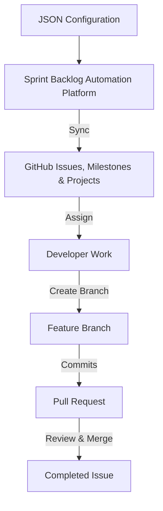

# 25. GitHub Project Management & Automation Workflow

This document governs the GitHub Project Management workflow, backlog automation infrastructure, naming conventions, and lifecycle processes for the Bakery ERP project.

---

## 1. Project Management Workflow Overview

We use an automated, configuration-driven Agile Scrum process. Project backlogs are maintained in version-controlled JSON files and synchronized with GitHub using GitHub CLI (`gh`).



---

## 2. Naming Conventions

Strict adherence to naming conventions ensures traceability from requirements to code changes.

### A. Issue Naming Convention
Issues must follow the format: `[ID] Title`
- **ID formats**:
  - Epics: `[EPIC-<MODULE>]` (e.g. `[EPIC-PROCUREMENT-FOUNDATION]`)
  - Features: `[FEAT-<MODULE>-<NAME>]` (e.g. `[FEAT-PR-SUBMIT]`)
  - Tasks: `[TASK-<MODULE>-<SEQ>]` (e.g. `[TASK-PR-001]`)
- **Example**: `[TASK-PR-001] Design Prisma models for Procurement`

### B. Branch Naming Convention
Branch names must reflect the issue type and ID they address.
- **Formats**:
  - Epics/Features: `feature/<issue-id>` (e.g. `feature/epic-procurement-foundation` or `feature/feat-pr-submit`)
  - Tasks: `task/<issue-id>` (e.g. `task/task-pr-001`)
  - Hotfixes: `hotfix/<issue-id>` (e.g. `hotfix/task-inventory-099`)
- All characters should be lowercase. Use hyphens to separate words.

### C. Commit Naming Convention
Commit messages must follow the conventional commits standard and reference the stable ID or issue number.
- **Format**: `<type>(<scope>): <description> [Issue ID]`
- **Types**:
  - `feat`: New feature or requirement
  - `fix`: Bug fix
  - `docs`: Documentation changes
  - `style`: Formatting, missing semi-colons, etc. (no production code change)
  - `refactor`: Refactoring code without behavior change
  - `test`: Adding missing tests, refactoring tests
  - `chore`: Build tasks, package updates, config modifications
- **Examples**:
  - `feat(procurement): add Prisma models for PR, PO, GR [TASK-DB-PRISM-MODELS]`
  - `fix(auth): resolve JWT expired time parsing issue [TASK-AUTH-005]`
  - `refactor(roles): simplify role validation hooks [TASK-ROLE-012]`

---

## 3. Automation Architecture & Folder Structure

Backlog synchronization is fully modularized under `.github/automation/github/`:
- `config/project.json`: Project board configurations including title, owner, visibility, and custom fields to provision.
- `config-loader.js`: Responsible for pre-flight validation, loading JSON schema definitions, mapping parents, and resolving label inheritance.
- `body-renderer.js`: Replaces markdown placeholders and builds checklists, metadata tables, and dependency relationship lists.
- `github-client.js`: Encapsulates all interactions with the `gh` CLI, metadata caching, project discovery, creation, and field provisioning.
- `runner.js`: Coordinates execution, logs history, writes execution cache, and outputs execution markdown reports.

### Configuration Hierarchy & Label Inheritance
Label inheritance cascades downward:
$$\text{Repository Default} \rightarrow \text{Sprint Default} \rightarrow \text{Epic Labels} \rightarrow \text{Feature Labels} \rightarrow \text{Task Labels}$$
Child nodes inherit all labels of their parent. To remove an inherited label at a child level, specify it with a `-` prefix (e.g., `"-backend"`).

---

## 4. Initialization & Setup

Before running any scripts, the environment must be authenticated and authorized with correct scopes.

### A. Authentication & Required Scopes
GitHub CLI must be logged in and refreshed with the following scopes:
- `repo` (Full repository control)
- `project` (Full project board integration control)
- `read:project` (Read project details)

If scopes are missing, run:
```bash
gh auth refresh -s repo -s read:project -s project
```

The `./setup.sh` script automatically validates the environment (checks installations, active token scopes, repository connectivity) and will fail fast if any requirements are missing.

### B. Project Discovery & Cache Behavior
On startup, the automation executes the project discovery flow:
1. **Cache Lookups**: It checks if `output/project.json` contains valid metadata (matching owner, repo, and title). If found, it skips remote discovery.
2. **Override Verification**: If CLI arguments or env variables specify `GITHUB_PROJECT_NUMBER`, it runs `gh project view` to load and cache metadata.
3. **Name-based Search**: If not cached or overridden, it queries `gh project list` to find a project matching the configured title (default: `"Bakery ERP"`).
4. **Provisioning / Creation**: If no matching project is found, it runs `gh project create` (in `LIVE` mode) to provision the board and caches the result.

---

## 5. Execution Modes

The platform supports multiple CLI execution flags:
- `--dry-run`: Evaluates configurations and logs what actions *would* be taken without executing any remote API modifications.
- `--live`: Runs live execution (creates/updates resources on GitHub).
- `--validate`: Performs JSON schema and relational validation checks (circular dependencies, duplicate IDs, missing parent IDs) and exits offline.
- `--sync`: Full synchronization mode (creates missing issues and updates existing ones if body, milestone, title, or labels differ).
- `--create-only`: Only creates missing issues, skipping any that already exist.
- `--update-only`: Only updates existing issues when local configurations differ from GitHub.
- `--repair`: Rebuilds the local cache file (`output/issues.json`) from scratch by searching active and closed issues on GitHub by Stable ID, re-resolving relationships, and updating parent/child dependency links without creating new issues.
- `--export`: Exports existing GitHub issues under a milestone into a local JSON backlog format.

### Command Defaults:
- `./setup.sh`: Always LIVE
- `./create-project.sh`: Default LIVE (use `--dry-run` to inspect)
- `./create-labels.sh`: Default LIVE
- `./create-milestones.sh`: Default LIVE
- `./create-sprint.sh`: Default DRY RUN (use `--live` or `--sync` to execute)

---

## 6. Two-Stage Repository Health Check & Validation Flow

Before any create/update or repair execution, the automation performs a mandatory, two-stage health check and validation flow. This prevents misleading remote failures by validating local files offline first.

### Phase 1: Configuration Validation (Offline)
Verifies local files and schemas before making any network requests. If validation fails, it aborts with a `Configuration Validation Failed` error:
- **Local Templates**: Ensures that the markdown template files (`epic.md`, `feature.md`, `task.md`) exist locally under `issues/templates/`.
- **Stable IDs**: Checks that all issues have unique, correctly formatted Stable IDs.
- **Labels Mapping**: Verifies that every label used in the backlog exists in `config/labels.json`.
- **Milestone Definition**: Verifies that the target milestone title exists in `config/milestones.json`.
- **Dependency Graph**: Validates parent/child mappings and detects circular dependency loops.

### Phase 2: Repository Validation (Online)
Runs after Phase 1 succeeds to verify GitHub credentials and resources:
- **Authentication**: Confirms the user is logged into GitHub CLI (`gh auth status`).
- **Scopes**: Validates token scopes (`repo`, `read:project`, `project`).
- **Repository Access**: Verifies the repository exists and is accessible.
- **Project Board**: Verifies the project board exists. If missing, suggests running: `./create-project.sh --live`.
- **GitHub Labels**: Verifies all required labels exist in the repository. If any are missing, aggregates them all and suggests running: `./create-labels.sh --live`.
- **GitHub Milestones**: Resolves target milestone and ensures it is ready. If missing, suggests running: `./create-milestones.sh --live`.
- **GitHub Assignees**: Verifies that every unique assignee in the sprint configuration exists and is assignable to the repository.
  - **"me" Alias Support**: Setting an assignee to `"me"` automatically resolves it to the authenticated GitHub CLI user's login.
  - **Strict Validation**: If `strictAssigneeValidation` is set to `true`, the health check aborts on any unassignable user.
  - **Non-Strict Fallback**: If `strictAssigneeValidation` is set to `false` (default in config), unassignable users log a warning, their `--assignee` parameter is omitted from issue CLI commands, and the automation continues.

---

## 7. Recovery & Resumption Processes

### Resume Workflow
If a script fails mid-sprint due to network errors, API rate limits, or credentials:
1. Fix the root cause (e.g., run `gh auth login` or refresh scopes).
2. Look at the exact resume command output by the failed script.
3. Rerun using that resume command. Since the runner writes cache entries immediately after each successful issue sync (rather than at the end), it will skip already sync'd items and continue safely.

### Rebuilding Cache (Repair)
If `output/issues.json` is deleted or corrupted, run:
```bash
./create-sprint.sh sprint2 --repair
```
This queries all open and closed issues on GitHub by their Stable IDs (`<!-- STABLE-ID: ... -->`), matches them back to the sprint configurations, updates their parent/child dependency links, and completely rebuilds the local cache file.

---

## 8. GitHub CLI vs. REST API Milestone Handling

A critical architectural distinction exists in milestone handling between the GitHub CLI (`gh`) and the GitHub REST API (`gh api`):

### A. GitHub CLI (`gh issue create / edit`)
The CLI command expects the **Milestone Title** (e.g. `--milestone "Sprint 2"`), not the numeric ID. Passing a number like `"1"` will cause errors because GitHub CLI looks for a milestone literally titled `"1"`.
- **Rule**: Always pass the string `title` to `--milestone` flags.

### B. GitHub REST API (`gh api`)
The REST API endpoints (GET, POST, PATCH) require the **Milestone Number** (e.g. `/milestones/1`) when targeting specific milestone resources.
- **Rule**: Always pass the resolved integer `number` to REST path variables.
