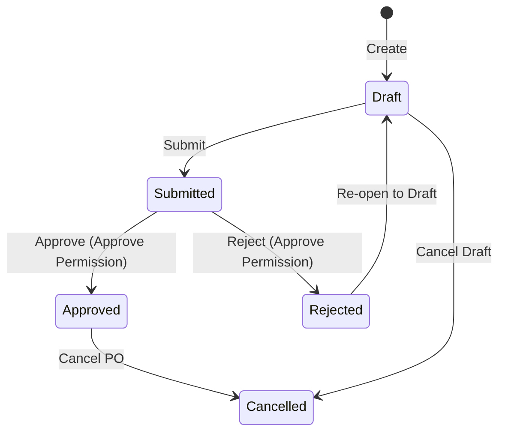

# 26. Procurement Domain

## 1. Business Purpose
The Procurement module manages supplier relationships, goods acquisition sourcing, and inventory replenishment requests. It ensures cost control, purchase authorization compliance, and receipt accuracy before items enter the outlet.
- **Target Users**: Purchasing Officers, Outlet Supervisors, Outlet Staff, Business Owner.

---

## 2. Master Data Dependencies
The following master data entities must exist for Procurement operations:
- **User**: For PR creation, approvals, and audits.
- **Product & Product Variant**: Items to be ordered (requires active status).
- **Unit of Measure (UOM)**: Quantities must map to product-defined UOMs.
- **Outlet**: Destination locations for goods delivery.

---

## 3. Core Entities
- **Vendor (Supplier)**: Code, Name, Email, Phone, Address, Tax Number, Default Payment Term ID, Status (Active/Inactive).
- **Purchase Request (PR)**: PR Number, Requestor ID, Destination Outlet ID, Expected Date, Total Estimated Amount, Status.
  - **PR Line Item**: Product ID, Quantity, UOM ID, Estimated Price, Subtotal.
- **Purchase Order (PO)**: PO Number, PR ID (required for MVP), Vendor ID, Destination Location ID, Order Date, Payment Term ID, Payment Term Snapshot, Estimated Payment Due Date, Total Amount, Tax, Grand Total, Status.
  - **PO Line Item**: Product ID, Quantity, UOM ID, Unit Price, Subtotal, Tax, Total.
- **Goods Receipt (GR)**: GR Number, PO ID, Receive Date, Received By ID, Location ID, Status.
  - **GR Line Item**: Product ID, Ordered Quantity, Received Quantity, Accepted Quantity, Rejected Quantity (Waste/Discrepancy), UOM ID, Expiry Date.
- **Purchase Return**: Return Number, GR ID, PO ID, Vendor Snapshot, Outlet Snapshot, Return Date, Status.
  - **Return Line Item**: GR Item ID, Source Inventory Movement ID, Inventory Batch ID when applicable, Product Snapshot, UOM Snapshot, Batch/Lot Snapshot, Posted Accepted Quantity Snapshot, Previously Returned Quantity Snapshot, Return Quantity, Reason, Reason Description.

---

## 4. Entity Relationships
- **Vendor** 1 ── * has many * ──> **Purchase Order**
- **Purchase Request** 1 ── * optionally spawns * ──> **Purchase Order**
- **Purchase Order** 1 ── * can have many (partial receipts) * ──> **Goods Receipt**
- **Goods Receipt** 1 ── * can spawn many (discrepancy returns) * ──> **Purchase Return**
- **Purchase Order / Goods Receipt / Purchase Return** -> upstream source data for **Vendor Invoice** in Finance.

---

## 5. Status Lifecycle & State Machine

### Allowed Transitions:
- `Draft` -> `Submitted` (User submits for review)
- `Draft` -> `Cancelled` (User discards draft)
- `Submitted` -> `Approved` (Supervisor approves)
- `Submitted` -> `Rejected` (Supervisor rejects)
- `Rejected` -> `Draft` (User reverts to draft for edits)
- `Approved` -> `Cancelled` (Owner voids order)

### Forbidden Transitions:
- `Rejected` -> `Approved` (Must revert to draft first)
- `Cancelled` -> `Draft` (Cancelled requests are final)

---

## 6. Business Rules
1. **No PO without Vendor**: A Purchase Order must always link to a valid and Active Vendor.
2. **UOM Override**: Procurement documents may override item UOM using active master UOMs while preserving snapshots.
3. **Payment Term Source**: Purchase Orders auto-populate Payment Term from the selected Vendor default and may override it while the PO is editable.
4. **Estimated Payment Date Calculation**: Purchase Order estimated payment due date is backend-calculated as `orderDate + PaymentTerm.dueDays`; users must not edit it manually.
5. **Payment Term Snapshot**: Purchase Orders persist `paymentTermCode`, `paymentTermName`, and `paymentTermDueDays` so historical documents remain readable when master data changes.
6. **PO vs AP Due Date**: Purchase Order `estimatedPaymentDueDate` is a commercial estimate only. Future Vendor Invoice / Accounts Payable records must calculate their authoritative due date from invoice business date and snapshotted payment-term policy.
7. **Legacy Payment Term Fields**: `Supplier.paymentTerms` and `PurchaseOrder.paymentTerms` are deprecated compatibility fields. New reads/writes must use Payment Term master references and snapshots.
8. **Receipt Validation**: Goods Receipt quantities cannot exceed the original PO quantity unless a specific tolerances policy (e.g., max +5%) is enabled.
9. **Goods Receipt Quantity Invariant**: `acceptedQuantity + rejectedQuantity + damagedQuantity + pendingQuantity <= eligible PO quantity`.
10. **Goods Receipt Quantity Semantics**: Accepted, rejected, and damaged quantities reduce Purchase Order remaining quantity. Pending quantity is recorded for follow-up but does not reduce Purchase Order remaining quantity.
11. **Quantity Source of Truth**: Goods Receipt item `previouslyReceivedQuantity` and `remainingQuantity` are creation-time snapshots. Authoritative remaining quantity must be derived from Purchase Order item balances and finalized Goods Receipt items unless a later approved transactional balance strategy supersedes it.
12. **Inventory Sync**: Inventory stock levels under `Inventory` are only increased when the Goods Receipt transitions to `Completed`, and only accepted quantities create inventory batch stock and inventory movement records.
13. **Goods Receipt Batch Posting**: Goods Receipt batch allocations must classify quantity as `ACCEPTED`, `REJECTED`, `DAMAGED`, or `PENDING`. Only `ACCEPTED` batch allocations create inventory stock and inventory movements. Accepted batch-tracked quantities must have batch allocation and expiry date before inventory posting because `InventoryBatch.expiredDate` is required by the current inventory schema.
14. **Goods Receipt Returnable Source**: Future Purchase Return returnable quantity must be derived from successfully posted accepted inventory movement quantities, minus finalized purchase return quantities. Do not rely exclusively on `GoodsReceiptItem.acceptedQuantity`.
15. **Purchase Return Source**: Purchase Return must originate from a completed Goods Receipt and must reference the posted accepted inventory movement or canonical source movement key used for future stock reversal.
16. **Purchase Return Quantity Source of Truth**: Purchase Return stores creation-time snapshots (`postedAcceptedQuantity`, `previouslyReturnedQuantity`, `returnQuantity`) for audit and rendering. Returnable quantity remains derived from posted accepted inventory minus finalized returned quantity; do not introduce a second authoritative return balance.
17. **Purchase Return Reason**: Return reasons use controlled values: `DAMAGED`, `WRONG_ITEM`, `QUALITY_ISSUE`, `EXPIRED`, `OVER_DELIVERY`, and `OTHER`. `reasonDescription` is mandatory when the reason is `OTHER`.
18. **Purchase Return Reservation**: Draft purchase returns do not reserve stock. Submitted purchase returns reserve returnable quantity. Cancelled purchase returns release that reservation. Returnable quantity is `postedAcceptedQuantity - completedReturnQuantity - submittedReturnQuantity`.
19. **Purchase Return Completion Boundary**: Purchase Return transitions to `COMPLETED` only when inventory stock reversal succeeds in the same transaction. The atomic completion flow is: validate return, validate inventory, create Stock Movement OUT using `MovementType.RETURN`, decrease outlet/batch stock, update Purchase Return to `COMPLETED`, write history, commit. Repeated completion of an already completed Purchase Return is idempotent success only when the deterministic reversal movement already exists.
20. **Vendor Invoice Boundary**: Vendor Invoice belongs to Finance. Procurement documents provide source references only. Billable quantity for Vendor Invoice must derive from posted accepted inventory movements minus finalized Purchase Returns and previously invoiced quantity. Finance Three-Way Matching uses Purchase Order, Goods Receipt, Purchase Return, and Vendor Invoice references without changing Procurement document lifecycles.

---

## 7. Validation Rules
- **Quantities**: Must be positive integers/decimals > 0.
- **Prices**: Must be greater than or equal to 0.
- **Dates**: Expected/Due dates must be tomorrow or later relative to the document creation date.
- **Payment Term Master**: Due days must be a non-negative integer (e.g., 0, 15, 30, 45, 60). Inactive payment terms remain visible on historical documents but are not selectable for new Supplier or PO records.

---

## 8. Approval Workflow
- **PR Threshold**: PRs with a total estimated amount under Rp 500.000 require Outlet Supervisor approval. PRs of Rp 500.000 or above require Owner approval.
- **PO Generation**: For the Sprint 2 MVP, POs can only be generated from an `Approved` PR.

---

## 9. Domain Events
- `PurchaseRequestSubmitted`: Fired when a PR enters `Submitted` state.
- `PurchaseRequestApproved`: Fired when a PR is approved.
- `PurchaseOrderCreated`: Fired when a PO is dispatched.
- `GoodsReceiptCompleted`: Fired when a GR is completed and inventory is adjusted.
- `PurchaseReturnDispatched`: Fired when returns are shipped back to the vendor.

---

## 10. Numbering Convention
- **Purchase Request**: `PR-YYYY-XXXXXX` (e.g. `PR-2026-000001`)
- **Purchase Order**: `PO-{outletNumber}-YYYY-XXXXXX` (e.g. `PO-OT-RETAIL-01-2026-000001`)
- **Goods Receipt**: `GR-YYYY-XXXXXX` (e.g. `GR-2026-000001`)
- **Purchase Return**: `RTN-YYYY-XXXXXX` (e.g. `RTN-2026-000001`)

---

## 11. Permission Matrix
- `procurement.pr.create` -> `OWNER`, `SUPERVISOR_OUTLET`
- `procurement.pr.approve` -> `OWNER`, `SUPERVISOR_OUTLET` (below Rp 500.000 threshold)
- `procurement.po.create` -> `OWNER`, `ADMIN_GUDANG`
- `procurement.po.approve` -> `OWNER`
- `procurement.po.read` -> `OWNER`, `SUPERVISOR_OUTLET`, `ADMIN_GUDANG`, `PRODUKSI`, `KASIR`
- `procurement.po.update` -> `OWNER`, `ADMIN_GUDANG`
- `procurement.po.manage` -> `OWNER`
- `procurement.gr.read` -> `OWNER`, `SUPERVISOR_OUTLET`, `ADMIN_GUDANG`, `PRODUKSI`
- `procurement.gr.create` -> `OWNER`, `ADMIN_GUDANG`
- `procurement.gr.update` -> `OWNER`, `ADMIN_GUDANG`
- `procurement.gr.complete` -> `OWNER`, `ADMIN_GUDANG`
- `procurement.gr.manage` -> `OWNER`, `ADMIN_GUDANG`
- `procurement.return.read` -> `OWNER`, `SUPERVISOR_OUTLET`, `ADMIN_GUDANG`, `PRODUKSI`, `KASIR`
- `procurement.return.create` -> `OWNER`, `ADMIN_GUDANG`
- `procurement.return.update` -> `OWNER`, `ADMIN_GUDANG`
- `procurement.return.complete` -> `OWNER`, `ADMIN_GUDANG`
- `procurement.return.manage` -> `OWNER`, `ADMIN_GUDANG`

---

## 12. UI Screen Layout Blueprint
Standard screen layout for the Procurement dashboard pages:
- **Header**: Title, Module Badge, and Primary Action Buttons (e.g., "New Purchase Request").
- **Filters**: Date range picker, Status single select, Location filter, and Search box.
- **Data Table**: Columns matching entity summaries with nested action controls.
- **Form Dialog**: Multitab slide-over drawer:
  - Tab 1: General Info (Vendor, Delivery Dates, Payment Terms).
  - Tab 2: Line Items Detail (dynamic check-list table with product searches).
- **Approval Timeline / History**: Right sidebar showing transition timestamps and user comments.
- **Attachments**: Drag-and-drop file uploader for invoices or vendor quotations.
- **Comments**: Internal threaded discussion notes section.

---

## 13. Typical API Blueprint
- `POST /api/v1/purchase-requests` (Create PR)
- `POST /api/v1/purchase-requests/:id/approve` (Approve PR)
- `POST /api/v1/purchase-orders` (Create PO)
- `GET /api/v1/purchase-orders/:id` (Get PO details)
- `POST /api/v1/goods-receipts` (Record Goods Receipt)
- `PATCH /api/v1/purchase-returns/:id/status` (Update return status)

---

## 14. Reports
- **Vendor Spend Summary**: Monthly spend broken down by supplier.
- **Order Fulfilment Rate**: Average lead time between PO creation and Goods Receipt completion.
- **Waste & Discrepancy report**: Summary of rejected items on receipt.

---

## 15. Integration Points & Notifications
- **Inventory module**: Triggers stock increase hook upon `GoodsReceiptCompleted`.
- **Finance module**: Generates vendor account payables upon invoice matching on `GoodsReceiptCompleted`.
- **Finance module**: Creates Vendor Invoice from eligible PO/GR receipt data, then prepares Accounts Payable after Vendor Invoice posting.
- **Notifications**: Email dispatched to Owner when a PO exceeds $1000 and requires approval.

---

## 16. Future Extension
- **Supplier Portal**: Secure vendor log-in to view and confirm PO orders directly.
- **Automated Replenishment**: Minimum inventory threshold notifications triggering automated PR generation.
