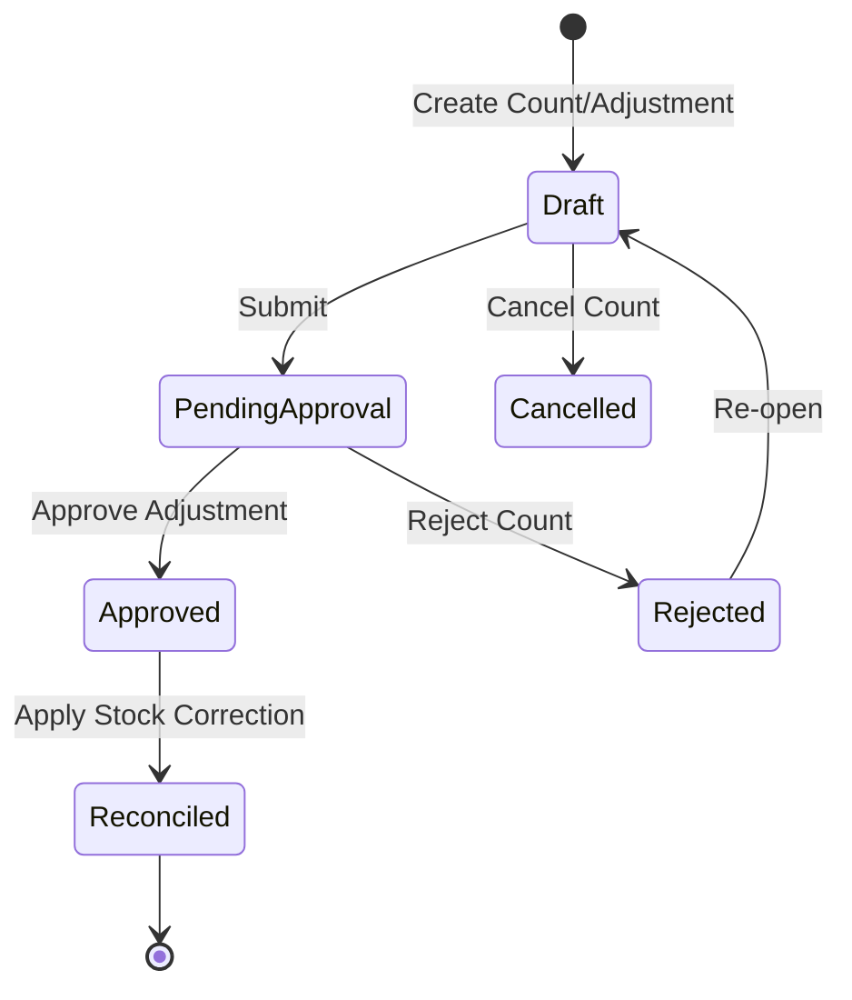

# 27. Inventory Domain

> **Current Architecture (SaaS Issue 7+)**: Inventory is **outlet-native**. The Warehouse
> layer has been completely removed — it does not exist as a domain concept and must not be
> reintroduced. `InventoryBatch` and `InventoryMovement` are directly outlet-scoped:
> `InventoryBatch -> Outlet -> Company` and `InventoryMovement -> Outlet -> Company`.
> Tenant isolation is defined by `TenantContext.accessibleOutletIds`; OWNER (company-wide)
> expansion happens only at the tenant/access layer (`OutletAccessService`
> `getAccessibleOutletsForMembership`), never inside Inventory services. Remaining
> "warehouse" wording below in historical/section text refers to the removed legacy layer
> and must be read as *outlet*.

## 1. Business Purpose
The Inventory module tracks the physical quantity, location, value, and movement of raw ingredients, packaging materials, and finished goods across all outlets. It ensures stock accuracy, minimizes waste, and coordinates item transfers.
- **Target Users**: Outlet Staff, Outlet Supervisors, Production Staff, Business Owner.

---

## 2. Master Data Dependencies
The following master data entities must exist for Inventory operations:
- **Product & Product Variant**: Stock items to be tracked.
- **Outlet**: Storage location. Warehouse no longer exists as a location layer.
- **Unit of Measure (UOM)**: Conversions between stocking, purchasing, and production recipes.

---

## 3. Core Entities
- **Stock Item (Inventory)**: Location ID, Product ID, Current Quantity, Reserved Quantity, Average Unit Cost, Min Stock Threshold, Max Stock Threshold.
- **Stock Transfer**: Transfer Number, Source Outlet, Destination Outlet, Status, audit fields.
  - **Transfer Line Item**: Product ID, source InventoryBatch, transfer quantity, UOM snapshot, batch/lot/expiry snapshot.
- **Stock Adjustment**: Adjustment Number, Outlet, Adjustment Date, Status, notes, audit fields.
  - **Adjustment Line Item**: exact InventoryBatch, direction (`IN`/`OUT`), adjustment quantity, reason, reason description, product/UOM/batch snapshots, and authoritative before/after quantity snapshots persisted only when completed.
- **Stock Opname (Physical Count)**: Opname Number, Location ID, Count Date, Status.
  - **Opname Line Item**: Product ID, Expected Quantity, Counted Quantity, Discrepancy Quantity, UOM ID, Status (Counted/Re-counted/Resolved).

---

## 4. Entity Relationships
- **Outlet** 1 ── * contains many * ──> **Stock Item**
- **Stock Transfer** 1 ── 2 (Source & Destination) ──> **Outlet**
- **Stock Opname** 1 ── * generates many * ──> **Stock Adjustment** (to reconcile count differences)

---

## 5. Status Lifecycle & State Machine

### Allowed Transitions:
- `Draft` -> `PendingApproval` (Staff submits count sheet)
- `Draft` -> `Cancelled` (Adjustment aborted)
- `PendingApproval` -> `Approved` (Supervisor approves recounts)
- `PendingApproval` -> `Rejected` (Supervisor rejects counts, triggers recount)
- `Rejected` -> `Draft` (Re-open count for edits)
- `Approved` -> `Reconciled` (Physical stock tables updated)

### Forbidden Transitions:
- `PendingApproval` -> `Reconciled` (Cannot apply corrections without approval)
- `Reconciled` -> `Draft` (Reconciled balances are locked)

---

## 6. Business Rules
1. **FIFO Allocation**: Stock movement (especially perishable ingredients) should follow First-In-First-Out (FIFO) principles.
2. **Negative Stock Ban**: Physical stock quantities cannot drop below zero. If an operation causes stock to go negative, it must halt and throw an error.
3. **Opname Lock**: During an active Stock Opname, the target location's inventory must restrict write operations (no transfers or sales order deductions) to ensure recount integrity.
4. **Goods Receipt Posting**: Completing a Goods Receipt posts only `ACCEPTED` batch allocations to inventory. Rejected, damaged, and pending quantities do not increase available stock.
5. **Posting Idempotency**: A Goods Receipt must not post stock more than once. `GoodsReceipt.inventoryPostedAt` is the service-level posting marker, and `InventoryMovement` must also store a deterministic source key so duplicate source allocation posting is blocked by the database.
6. **Stock Mutation Concurrency**: Every `InventoryBatch.qtyAvailable` balance mutation must commit atomically with its `InventoryMovement` ledger entry and must use a concurrency-safe transaction strategy. Direct read-compute-write stock updates without protection against lost updates are forbidden.
7. **Inventory Reconciliation Safety**: Inventory reconciliation is read-only by default. Historical balance repair must never silently modify `InventoryBatch` or `InventoryMovement` and requires an explicit controlled correction workflow.
8. **Stock On Hand Source**: Stock On Hand reads the current balance from `InventoryBatch.qtyAvailable`. It must not calculate current list balances by summing `InventoryMovement` on every request; `InventoryMovement` remains the immutable ledger/source trace and reconciliation input.
9. **Stock Ledger Source**: Stock Ledger reads from `InventoryMovement` as the immutable inventory ledger. Historical movement rows must not be edited or deleted; corrections require future counter/reversal inventory transactions.
10. **Batch Expiry Requirement**: Goods Receipt `ACCEPTED` batches that create inventory stock must provide an expiry date because `InventoryBatch.expiredDate` is required.
11. **Batch/Lot Business Key**: Inventory batch identity is `outlet + product + batchNumber + lotKey` (database unique key `InventoryBatch_outlet_product_batch_lot_key`). `lotKey` is the normalized nullable-safe value of `lotNumber`; empty lot is represented as an empty key. This prevents different vendor lots with the same batch number from being merged while keeping no-lot batches deterministic.
12. **Purchase Return Source**: Purchase Return returnable quantity must be calculated from posted accepted inventory movements and finalized return movements, not only from Goods Receipt item snapshots.
13. **Purchase Return Reversal**: Completing a Purchase Return creates an outbound inventory movement using the canonical `MovementType.RETURN`, reduces the exact source `InventoryBatch`, preserves batch/lot identity, and must commit atomically with `PurchaseReturn.status = COMPLETED`. Duplicate reversal is blocked by the deterministic inventory movement source key.
14. **Batch & Expiry Management**: Batch & Expiry Management is a read-only monitoring view over `InventoryBatch`, not `GoodsReceiptBatch`. Expiry state is backend-derived using the business date and the MVP threshold `INVENTORY_EXPIRY_SOON_DAYS = 30`, which is a future configurable-policy candidate. `expiryDate < businessDate` is `EXPIRED`; `expiryDate == businessDate` remains valid for that business day and is classified as expiring soon. Expired stock remains visible with its current `qtyAvailable` until a future explicit inventory transaction changes stock.
15. **Non-Batch Inventory Display**: Synthetic non-batch `InventoryBatch` rows remain unchanged in the database. Batch & Expiry hides them by default, but when explicitly included they must be marked `NOT_APPLICABLE` and displayed with Batch, Lot, and Expiry as `-`.
16. **Stock Transfer Lifecycle**: Stock Transfer uses `DRAFT -> SUBMITTED -> IN_TRANSIT -> COMPLETED`, with `DRAFT -> CANCELLED` and `SUBMITTED -> CANCELLED` allowed. `SUBMITTED` locks the document and does not mutate stock. Dispatch changes `SUBMITTED -> IN_TRANSIT` and creates `TRANSFER_OUT`; receive changes `IN_TRANSIT -> COMPLETED` and creates `TRANSFER_IN`.
17. **Stock Transfer Inventory Semantics**: In-transit stock is not available at either source or destination outlet. For MVP, `transferQty = dispatchQty = receiveQty`; partial dispatch, partial receive, damaged-in-transit, and lost-in-transit require separately approved workflows.
18. **Stock Transfer Batch Identity**: Transfer preserves product, batch number, lot key, and expiry from the source `InventoryBatch`. Destination `InventoryBatch` is resolved by `outlet + product + batchNumber + lotKey` or created if missing. Completed transfers must preserve global stock quantity: source decrease equals destination increase. Transfer create must validate BOTH `sourceOutletId` and `destinationOutletId` through canonical tenant/company/inventory-capability scope before any draft is persisted.
19. **Stock Adjustment Lifecycle**: Stock Adjustment uses `DRAFT -> SUBMITTED -> APPROVED -> COMPLETED`, with only `DRAFT -> CANCELLED` and `SUBMITTED -> CANCELLED` allowed. `DRAFT` is editable. `SUBMITTED` locks the document and does not mutate stock. `APPROVED` authorizes posting and is not cancellable. `COMPLETED` is terminal.
20. **Stock Adjustment Posting**: Stock Adjustment is an explicit correction document. It must never directly trust frontend-provided before/after stock. Draft create/update stores only the adjustment intent. On completion, the backend reloads the exact `InventoryBatch` inside a concurrency-safe transaction, derives authoritative `beforeQty`/`afterQty`, mutates `InventoryBatch.qtyAvailable`, creates immutable inventory movement rows, writes history, and commits atomically.
21. **Stock Adjustment Scope**: MVP Stock Adjustment may operate only on existing `InventoryBatch` records. It must not implicitly create a new batch. `OUT` adjustments must not produce negative stock. `EXPIRED` reason is valid only when the shared expiry classifier marks the batch expired using `expiryDate < businessDate`; `expiryDate == businessDate` remains valid for that business day.
22. **Stock Adjustment Movement Semantics**: New executable adjustment posting must use explicit movement types: `ADJUSTMENT_IN` increases stock and `ADJUSTMENT_OUT` decreases stock. Legacy `ADJUSTMENT` remains historical/diagnostic and must not be used for new executable posting.
23. **Stock Opname Lifecycle**: Stock Opname uses `DRAFT -> COUNTING -> SUBMITTED -> APPROVED -> COMPLETED`, with `DRAFT -> CANCELLED`, `COUNTING -> CANCELLED`, and `SUBMITTED -> CANCELLED` allowed. `APPROVED` and `COMPLETED` are not cancellable through normal workflow.
24. **Stock Opname Snapshot and Lock**: `DRAFT -> COUNTING` captures a frozen `InventoryBatch.qtyAvailable` snapshot into Stock Opname items inside a concurrency-safe transaction. Outlet stock mutation is hard-locked while the Stock Opname is `COUNTING`, `SUBMITTED`, or `APPROVED`; the lock is released only by `COMPLETED` or `CANCELLED`.
25. **Stock Opname Correction Boundary**: Stock Opname must never directly mutate `InventoryBatch`. On completion, non-zero variance creates exactly one generated Stock Adjustment with `sourceDocumentType = STOCK_OPNAME`, `sourceDocumentId = StockOpname.id`, and `sourceDocumentNumber = opnameNumber`; that adjustment is business-approved by the Stock Opname and posts through canonical `ADJUSTMENT_IN`/`ADJUSTMENT_OUT` logic. Zero-variance completion creates no Stock Adjustment and no InventoryMovement. Legacy `MovementType.OPNAME` remains non-executable/diagnostic.
26. **Inventory Dashboard Read Model**: Inventory Dashboard is read-only monitoring. It aggregates scoped backend data from `InventoryBatch.qtyAvailable`, `InventoryMovement`, `StockTransfer.IN_TRANSIT`, and Inventory Reconciliation; it must not mutate stock, calculate authoritative totals from paginated frontend rows, perform valuation/costing, auto-create replenishment, or run reconciliation repair.
27. **Low Stock Monitoring MVP**: Low Stock uses existing `Product.minimumStock`. `minimumStock <= 0` disables low-stock monitoring for that product. Evaluation is at `Product + Outlet` level using existing operational `InventoryBatch` footprint only; the system must not generate unrestricted Product x Outlet out-of-stock rows unless a future canonical OutletProductStockPolicy/assignment is approved.
28. **Inventory Hardening Test Safety**: Database-backed inventory concurrency tests must run only against an explicitly configured isolated test database using `INVENTORY_INTEGRATION_DATABASE_URL`. The test database must not equal `DATABASE_URL`, must be clearly test-only, and fixture cleanup must be scoped to test-owned records. Development or production databases must never be reset or mutated by hardening tests.
29. **Inventory Read Tenant Scope**: Inventory read-side endpoints must use `TenantContext.permissions` and backend-derived `accessibleOutletIds`. Inventory is outlet-native: read scope is proven directly through `InventoryBatch/InventoryMovement -> Outlet -> Company` (no Warehouse layer). List, dashboard, and reconciliation queries must apply company/outlet scope before pagination or aggregation. Direct batch/movement/reconciliation detail must independently validate both `outlet.companyId == tenant.companyId` and `outletId in tenant.accessibleOutletIds`. An explicit `outletId` query filter must be UUID-validated and asserted accessible; an inaccessible or foreign outlet returns `403 Forbidden`, never a silently empty list. Ledger source references must not expose document number or route when the source document is outside the active tenant scope.
30. **Inventory Mutation Tenant Scope**: Stock Transfer, Stock Adjustment, and Stock Opname mutation endpoints must use `TenantContext.permissions` and backend-derived `accessibleOutletIds`; legacy `User.outletId` is not an authorization source. Inventory is outlet-native: mutation scope is proven directly through `Outlet -> Company`. Stock-changing transitions must reload the authoritative document/location inside the same Serializable transaction, revalidate `outlet.companyId == tenant.companyId` and the required accessible outlet policy, then apply lock/status/stock invariants before mutating `InventoryBatch` or appending `InventoryMovement`. Transfer create must validate both source and destination outlets for tenant company scope and inventory capability before persisting a draft; dispatch requires source outlet access plus same-company destination; receive requires destination outlet access plus same-company source. Stock Opname generated Stock Adjustment may bypass only its own stock-count lock through deterministic `sourceDocumentType = STOCK_OPNAME` and matching `sourceDocumentId`; it is not a general tenant or authorization bypass. Owner/company-wide access is expressed exclusively by the tenant-built `accessibleOutletIds`; Inventory services must never branch on `role === 'OWNER'`.

---

## 7. Validation Rules
- **Quantities**: Real counted quantities must be positive numbers >= 0.
- **Expiry Dates**: Expiry checks must be recorded for perishables during receipt and count.
- **Reason Codes**: Reason codes are mandatory for all adjustments.

---

## 8. Approval Workflow
- **Adjustment Approval**: Stock Adjustment requires explicit approval before stock mutation. `APPROVED` adjustments can be completed by users with the approved completion permission/scope. Value-based approval limits are a future policy extension.
- **Transfers**: `SUBMITTED` transfers require dispatch confirmation at the source outlet and receive confirmation at the destination outlet. Same-outlet transfers may be performed by scoped users with transfer permissions; cross-outlet transfers require manage/global policy.

---

## 9. Domain Events
- `StockLevelLow`: Fired when current quantity drops below min stock threshold.
- `StockTransferDispatched`: Fired when a transfer departs source location.
- `StockTransferReceived`: Fired when destination outlet confirms receipt.
- `StockOpnameCompleted`: Fired when physical counts are finalized.
- `StockAdjusted`: Fired when ledger balances are updated.

---

## 10. Numbering Convention
- **Stock Transfer**: `TRF-YYYY-XXXXXX` (e.g. `TRF-2026-000001`)
- **Stock Adjustment**: `ADJ-YYYY-XXXXXX` (e.g. `ADJ-2026-000001`)
- **Stock Opname**: `OPN-YYYY-XXXXXX` (e.g. `OPN-2026-000001`)

---

## 11. Permission Matrix
- `inventory.read` -> Inventory read views including Inventory Dashboard, Stock On Hand, Stock Ledger, Batch & Expiry, and reconciliation visibility
- `inventory.transfer.create` -> `OWNER`, `SUPERVISOR_OUTLET`, `ADMIN_GUDANG`
- `inventory.transfer.receive` -> `OWNER`, `SUPERVISOR_OUTLET`, `ADMIN_GUDANG`
- `inventory.adjustment.read`
- `inventory.adjustment.create`
- `inventory.adjustment.update`
- `inventory.adjustment.approve`
- `inventory.adjustment.complete`
- `inventory.adjustment.manage`
- `inventory.stock-count.read`
- `inventory.stock-count.create`
- `inventory.stock-count.update`
- `inventory.stock-count.approve`
- `inventory.stock-count.complete`
- `inventory.stock-count.manage`

---

## 12. UI Screen Layout Blueprint
- **Header**: Outlet selection drop-down, Last Count Date display, count actions.
- **Filters**: Product Category, Stock Level status (OK, Low, Out of Stock).
- **Data Table**: Displays Product, SKU, Current Count, Reserved Count, UOM, and status badges.
- **Form Dialog**: Counts entry grid allowing offline-capable barcode scanning input.
- **Approval Timeline**: Logs when count sheets were submitted and who reconciled variances.
- **Attachments**: CSV upload templates for bulk count imports.
- **Comments**: Internal notes for count discrepancies (e.g. "Water damage on bottom row").

---

## 13. Typical API Blueprint
- `GET /api/v1/inventory/locations/:id/stock` (List stock levels)
- `GET /api/v1/inventory/dashboard` (Read-only inventory monitoring dashboard)
- `POST /api/v1/inventory/transfers` (Create stock transfer request)
- `POST /api/v1/inventory/transfers/:id/submit` (Lock transfer document without stock mutation)
- `POST /api/v1/inventory/transfers/:id/dispatch` (Post `TRANSFER_OUT`)
- `POST /api/v1/inventory/transfers/:id/receive` (Confirm transfer receipt)
- `POST /api/v1/inventory/opnames` (Start stock counting sheet)
- `POST /api/v1/inventory/stock-counts/:id/start` (Capture snapshot and lock outlet stock)
- `PUT /api/v1/inventory/stock-counts/:id/items/:itemId/count` (Record physical quantity)
- `POST /api/v1/inventory/stock-counts/:id/complete` (Complete through generated Stock Adjustment)
- `POST /api/v1/inventory/adjustments` (Create stock adjustment draft)
- `POST /api/v1/inventory/adjustments/:id/submit` (Lock adjustment without stock mutation)
- `POST /api/v1/inventory/adjustments/:id/approve` (Approve adjustment without stock mutation)
- `POST /api/v1/inventory/adjustments/:id/complete` (Post `ADJUSTMENT_IN`/`ADJUSTMENT_OUT`)

---

## 14. Reports
- **Stock Valuation Report**: FIFO inventory assets value by outlet location.
- **Inventory Variance Summary**: Counted vs. system variance totals.
- **Discrepancy & Waste log**: Quantified cost of damaged/expired inventory.

---

## 15. Integration Points & Notifications
- **Procurement module**: Goods Receipt completion creates purchase inventory movements with `referenceType = GOODS_RECEIPT`.
- **Production module**: Deducts ingredient inventory upon production logs completion.
- **Sales POS module**: Deducts finished goods inventory upon POS sales transactions.
- **Notifications**: Automated alert sent to Outlet Staff when Min Stock levels are breached.

---

## 16. Future Extension
- **Barcode Printing**: Direct barcode labels printing from stock entries.
- **Multi-zone Warehousing**: Inventory mapping down to rack, aisle, and bin configurations.
