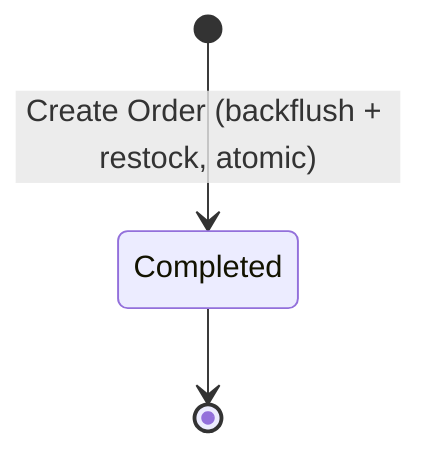
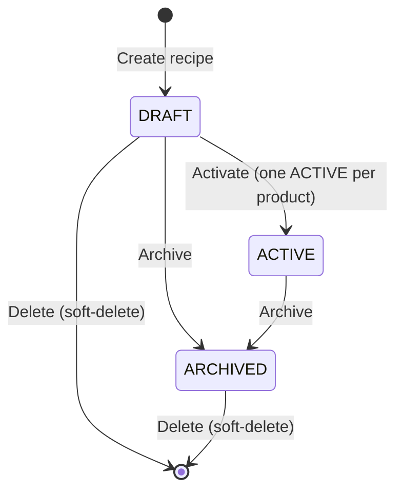

# 28. Production Domain

## 1. Business Purpose
The Production module converts raw ingredients into finished bakery goods. It manages recipes (Bill of Materials) and executes production runs that backflush ingredients and restock finished goods.

Production Orders are **INSTANT-COMPLETE** (decision 1b, option A): creating a production order IS the production run. In a single action the system resolves the finished product's `ACTIVE` recipe, backflushes ingredients via FEFO, produces the finished-goods batch, records the target / actual / waste quantities, and lands the order directly on `COMPLETED`. There is no multi-step scheduling, no separate yield/QA/complete steps, and no cancellation. This models fast in-outlet production at the point of sale.
- **Target Users**: Production Staff, Outlet Supervisors, Business Owner, Cashier (fast in-outlet production).

---

## 2. Master Data Dependencies
The following master data entities must exist for Production operations:
- **Product**: Raw materials (flour, sugar) and finished goods (breads, cakes).
- **Unit of Measure (UOM)**: Precise conversions (e.g. grams, kilograms, pieces).
- **Outlet**: Location from which ingredients are deducted and where finished goods are stocked.

---

## 3. Core Entities
- **Recipe (Bill of Materials - BOM)**: Recipe Name, Finished Product ID, Yield Quantity, Yield UOM ID, Instructions, Status (Active/Draft/Archived).
  - **Recipe Ingredient**: Ingredient Product ID, Required Quantity, UOM ID, Loss Percentage (allowance for wastage).
- **Production Order**: Production Number, Location ID, Target Date, Recipe ID, Scheduled Quantity, Actual Produced Quantity, Wastage Quantity, Status.
- **Production Log**: Log Number, Production Order ID, Log Date, Logger ID, Hours Worked, Yield Quantity, Yield UOM ID, Quality Status (Passed/Failed).
  - **Ingredient Usage Log**: Ingredient Product ID, Actual Consumed Quantity, UOM ID, Batch Number (for traceability).

---

## 4. Entity Relationships
- **Recipe (BOM)** 1 ── * contains many * ──> **Recipe Ingredient**
- **Recipe (BOM)** 1 ── * defines yield for * ──> **Product** (Finished Good)
- **Production Order** 1 ── * executes * ──> **Recipe (BOM)**
- **Production Order** 1 ── * has many * ──> **Production Log**

---

## 5. Status Lifecycle & State Machine (INSTANT-COMPLETE)

A Production Order has a single status: `COMPLETED`. Creating the order runs the full production atomically and persists it already `COMPLETED`.



### Rules:
- There are **no intermediate states** (no `SCHEDULED` / `IN_PROGRESS` / `YIELD_COMPLETED`), **no QA step** (`QA_PASSED` / `QA_FAILED` removed), and **no `CANCELLED`**. Because nothing partial is ever persisted, there is no in-flight order to cancel: a create either fully succeeds (landing on `COMPLETED`) or fails and writes nothing (full rollback).
- `COMPLETED` is the only status and is terminal. Completed orders cannot be modified.
- The whole run (recipe resolution, FEFO backflushing, finished-goods batch creation, snapshots, status) commits in **one SERIALIZABLE transaction** or none of it does.

> **Historical note (removed design):** earlier the lifecycle was multi-step —
> `SCHEDULED -> IN_PROGRESS -> YIELD_COMPLETED -> QA_PASSED|QA_FAILED -> COMPLETED` plus
> `SCHEDULED -> CANCELLED` — with separate `start` / `yield` / `qa` / `complete` / `cancel`
> endpoints and a `qa_notes` field. These were consolidated into the single instant-complete
> create. The `qa_notes` column remains in the database for history but is no longer written or
> read (no drop migration). The `production_orders` status CHECK constraint still permits the
> legacy status strings (a superset); `COMPLETED` is within it, so no migration is required.

---

## 5a. Recipe (BOM) Lifecycle

A Recipe (BOM) is company-scoped and follows a separate, simpler lifecycle from the Production Order above.



### Rules
- **One ACTIVE per product**: At most one `ACTIVE` recipe may exist per finished product per company (enforced by a partial unique index plus an explicit check).
- **Delete is allowed for DRAFT and ARCHIVED (soft-delete)**: A recipe in `DRAFT` or `ARCHIVED` may be deleted; `ARCHIVED` recipes are deletable so stale archives that accumulate over time can be cleaned up. An `ACTIVE` recipe can **never** be deleted because it is currently in use (attempting to delete it raises `RECIPE.ACTIVE_NOT_DELETABLE`). Deletion is a soft-delete (`deleted_at` is set); the row and its items are retained in the database and hidden from all reads (every recipe query filters `deleted_at IS NULL`), so production history and references stay intact.
  - Delete is **not** a status transition. It does not change `status` and does not alter the allowed status transitions in `recipeStatus.ts`. Deleting an archive removes stale data; it never revives or reactivates the archive.
  - A soft-deleted recipe no longer participates in any recipe query, including the "one ACTIVE per product" rule and `getActiveByProduct`.
- **ARCHIVED is terminal**: An archived recipe is never reactivated. To revise an archived (or active) recipe, create a **new** recipe — the "duplicate-to-draft" model (decision B2): a fresh `DRAFT` is created, edited, and activated, which supersedes the previous active recipe. Archives are preserved as immutable history, never revived.

---

## 6. Business Rules
1. **Recipe Scalability**: Ingredient quantities scale linearly by `scaleFactor = scheduledQty / recipe.yieldQty`, applying each line's loss percentage (`required = baseQty * scaleFactor * (1 + loss/100)`).
2. **Auto-Deduction (Backflushing)**: Ingredient consumption is deducted from inventory (FEFO, `PRODUCTION_CONSUME`) as part of the single create transaction. If ingredient stock cannot cover the requirement the whole create fails with `INVENTORY.INSUFFICIENT_STOCK` (negative-stock ban) and nothing is persisted.
3. **Target / Actual / Waste (option A)**: Each order records `scheduledQty` (the production target), `actualQty` (finished goods that succeeded and enter stock), and `wasteQty` (failed/scrapped output that never enters stock). When `actualQty > 0` a finished-goods batch is created (`PRODUCTION_RESULT`) with the required `resultExpiredDate`; when `actualQty = 0` no finished batch is produced.
4. **Quantity validation**: `scheduledQty > 0`; `actualQty >= 0`; `wasteQty >= 0` (default 0); `resultExpiredDate` is required when `actualQty > 0`. No hard constraint ties `scheduledQty` to `actualQty + wasteQty` — over-yield and under-yield are both legitimate real-world outcomes.
5. **Traceability**: Finished-goods batches are created with their expiry date; consumed ingredient batches are snapshotted in `production_order_materials` for audit/reconciliation.
6. **Producible Quantity (read-only preview)**: Given a finished product + outlet, the backend computes the **maximum whole finished units** currently producible from on-hand ingredient stock. Per ingredient, `requiredPerUnit = baseQty * (1 + loss/100) / recipe.yieldQty` (the same loss% + yield math as backflushing rule #1, with `scaleFactor = 1 / yieldQty`), and `maxUnits = floor(availableQty / requiredPerUnit)`. `producibleQty = MIN(maxUnits)` across all ingredients; the ingredient(s) at that MIN are the **limiting** ones. Rounding is **floor to whole units** (production outputs integer units). Ingredient availability is the sum of `ACTIVE` `inventory_batches.qty_available` for that product+outlet (same Stock-On-Hand source of truth, rule #8). Edge cases: a `0`-requirement line never constrains; `0` stock → `producibleQty = 0`; empty recipe → `producibleQty = 0`. The per-unit consumption expression is **shared** with the instant-complete backflushing path (`Domains/production/productionConsumption.ts`) so the previewed number equals what a submit actually consumes.

---

## 7. Validation Rules
- **Yields**: Produced quantities cannot be negative.
- **Scaling Limits**: Recipes can only scale up or down within safe boundaries defined in the BOM config (e.g. min 0.5x, max 10x batch size).
- **Ingredients Stock**: Warn production staff if ingredient inventory levels are insufficient for scheduled runs.

---

## 8. Approval Workflow
- **Recipe Creation**: New recipes or changes to existing BOMs require Outlet Supervisor approval before they are marked as `Active`.
- **Production Order**: No approval workflow. Production is instant-complete — there is no QA gate and no supervisor review step between create and completion. QA has been removed from the production flow entirely.

---

## 9. Domain Events
- `ProductionCompleted`: Fired when a production order is created — ingredients are backflushed and finished goods restocked in the same action. (The former multi-step events `ProductionScheduled` / `ProductionStarted` / `YieldRecorded` / `QualityCheckFailed` no longer apply under the instant-complete model.)

---

## 10. Numbering Convention
- **Production Order**: `PRD-YYYY-XXXXXX` (e.g. `PRD-2026-000001`)
- **Production Log**: `LOG-YYYY-XXXXXX` (e.g. `LOG-2026-000001`)

---

## 11. Permission Matrix
- `production.recipe.create` -> `OWNER`, `SUPERVISOR_OUTLET`
- `production.order.schedule` -> `OWNER`, `SUPERVISOR_OUTLET`
- `production.order.execute` -> `OWNER`, `PRODUKSI`
- `production.qa.check` -> `OWNER`, `SUPERVISOR_OUTLET`

---

## 12. UI Screen Layout Blueprint
- **Header**: Production Schedule summary, active yield trackers, order actions.
- **Filters**: Date, Recipe ID, Status.
- **Data Table**: Displays scheduled orders, target yields, actual yield progress, and QA status.
- **Form Dialog**: Single instant-production form — pick outlet + finished product (ACTIVE recipe resolved), enter target (`scheduledQty`), actual (`actualQty`), waste (`wasteQty`), and the result expiry when `actualQty > 0`. Submitting runs and completes the order in one action.
- **Attachments**: SOP guides, recipe photos, or label printing templates.
- **Comments**: Notes on baking issues (e.g. "Oven temperature calibration off").

---

## 13. Typical API Blueprint

Production Orders (base `/api/v1/production/orders`, company-scoped, permission-guarded):
- `GET  /api/v1/production/orders` — list (read: `production-order.read`)
- `GET  /api/v1/production/orders/:id` — detail with materials + results (read: `production-order.read`)
- `POST /api/v1/production/orders` — **run production** (instant-complete; create = `COMPLETED`, backflushing) (write: `production-order.manage`)

Production reads (base `/api/v1/production`, company-scoped, permission-guarded):
- `GET /api/v1/production/producible?productId=<uuid>&outletId=<uuid>` — **producible-quantity preview** (read: `production-order.read`). READ-ONLY: posts no movements, mutates nothing. Resolves the product's `ACTIVE` recipe (`404 RECIPE.NO_ACTIVE_RECIPE` when none; `404 OUTLET.NOT_FOUND` when the outlet is not in the company) and returns the max whole producible units + per-ingredient requirement/availability/limiting flag (see Business Rule #6). Response: `{ productId, outletId, recipe: { id, recipeNumber, name, yieldQty, yieldUomId }, producibleQty, items: [{ ingredientProductId, uomId, requiredPerUnit, availableQty, isLimiting }] }`.

The former `:id/start`, `:id/yield` (log-yield), `:id/qa`, `:id/complete`, and `:id/cancel` endpoints have been **removed**.

### Create (= produce) contract
Request body:
```jsonc
{
  "outletId": "uuid",            // required
  "productId": "uuid",           // required (UI sends this); backend resolves the product's ACTIVE recipe
  "recipeId": "uuid",            // optional alternative to productId (recipe wins if both given)
  "scheduledQty": 40,            // required, > 0 — production target
  "actualQty": 38,               // required, >= 0 — succeeded, enters stock
  "wasteQty": 2,                 // optional, >= 0, default 0 — failed/scrapped, never enters stock
  "resultExpiredDate": "2026-10-05", // required when actualQty > 0 — finished-goods batch expiry
  "productionDate": "2026-10-03",    // optional, default today
  "notes": "optional (e.g. reason for waste)"
}
```
Response: `201` with the `COMPLETED` production order (header + `materials[]` + `results[]`).
Errors: `400` validation or `INVENTORY.INSUFFICIENT_STOCK`; `404` outlet not found or `RECIPE.NO_ACTIVE_RECIPE` (product has no ACTIVE recipe).

### Accessible outlets (supporting endpoint)
Production/POS UIs need the outlets the logged-in user may operate in, since the JWT does not carry an outlet:
- `GET /api/v1/outlets/accessible` — **authentication only, no `@RequirePermission`** (so operational roles such as cashier/production, which may lack `outlet.read`, can still resolve their outlets). Company-scoped. OWNER / super-admin receive every non-deleted outlet of the active company; other users receive only their `ACTIVE` `user_outlets` assignments. Returns a list of outlet objects (`id`, `code`, `name`, `address`, `phone`, `isActive`, ...).

---

## 14. Reports
- **Production Yield Analysis**: Scheduled vs. actual produced counts.
- **Ingredient Wastage Report**: Financial cost of ingredient over-consumption.
- **QC Pass Rate**: Percentage of items passing QA checks.

---

## 15. Integration Points & Notifications
- **Inventory module**: Triggers automatic ingredient inventory stock deduction upon order completion.
- **POS module**: Increases finished product inventories for sales availability.
- **Notifications**: Slack/Email alert to supervisor when a QC check fails.

---

## 16. Future Extension
- **IoT Oven Integration**: Direct temperature and baking time logs retrieval.
- **Machine Scheduling**: Automated machine queues and maintenance task routing.
