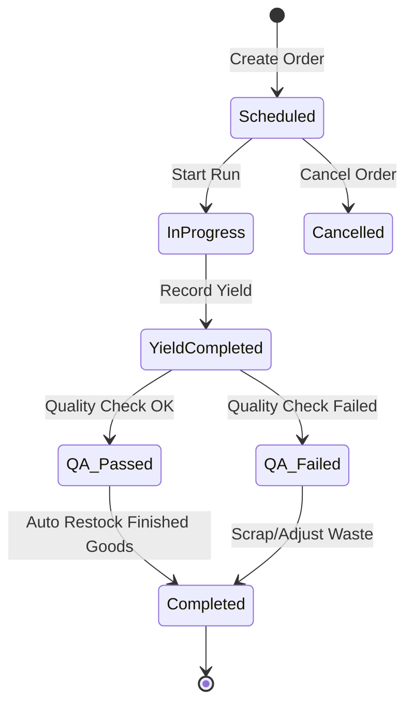
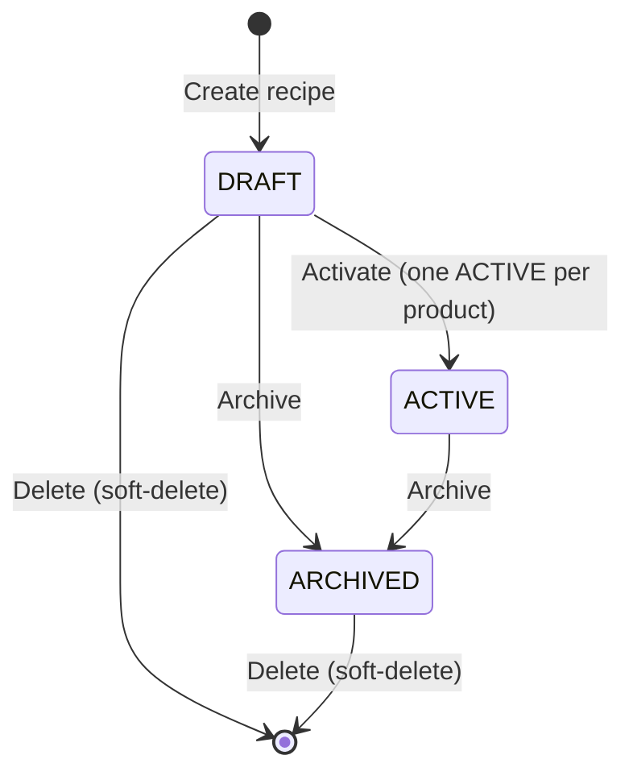

# 28. Production Domain

## 1. Business Purpose
The Production module converts raw ingredients into finished bakery goods. It manages recipes (Bill of Materials), schedules production runs, tracks production yields, logs ingredient consumption, and ensures quality control standards are maintained.
- **Target Users**: Production Staff, Outlet Supervisors, Business Owner.

---

## 2. Master Data Dependencies
The following master data entities must exist for Production operations:
- **Product**: Raw materials (flour, sugar) and finished goods (breads, cakes).
- **Unit of Measure (UOM)**: Precise conversions (e.g. grams, kilograms, pieces).
- **Outlet**: Location from which ingredients are deducted and where finished goods are stocked.

---

## 3. Core Entities
- **Recipe (Bill of Materials - BOM)**: Recipe Name, Finished Product ID, Yield Quantity, Yield UOM ID, Instructions, Status (Active/Draft/Archived).
  - **Recipe Ingredient**: Ingredient Product ID, Required Quantity, UOM ID, Loss Percentage (allowance for wastage).
- **Production Order**: Production Number, Location ID, Target Date, Recipe ID, Scheduled Quantity, Actual Produced Quantity, Wastage Quantity, Status.
- **Production Log**: Log Number, Production Order ID, Log Date, Logger ID, Hours Worked, Yield Quantity, Yield UOM ID, Quality Status (Passed/Failed).
  - **Ingredient Usage Log**: Ingredient Product ID, Actual Consumed Quantity, UOM ID, Batch Number (for traceability).

---

## 4. Entity Relationships
- **Recipe (BOM)** 1 ── * contains many * ──> **Recipe Ingredient**
- **Recipe (BOM)** 1 ── * defines yield for * ──> **Product** (Finished Good)
- **Production Order** 1 ── * executes * ──> **Recipe (BOM)**
- **Production Order** 1 ── * has many * ──> **Production Log**

---

## 5. Status Lifecycle & State Machine

### Allowed Transitions:
- `Scheduled` -> `InProgress` (Production starts mixing/baking)
- `Scheduled` -> `Cancelled` (Production cancelled before baking)
- `InProgress` -> `YieldCompleted` (Baking completed, count recorded)
- `YieldCompleted` -> `QA_Passed` (QC parameters satisfied)
- `YieldCompleted` -> `QA_Failed` (QC failed, batch is flagged)
- `QA_Passed` -> `Completed` (Deductions and stock adjustments completed)
- `QA_Failed` -> `Completed` (Scrapped, waste logged)

### Forbidden Transitions:
- `YieldCompleted` -> `Completed` (Must go through QA check first)
- `Completed` -> `InProgress` (Finished orders cannot be modified)

---

## 5a. Recipe (BOM) Lifecycle

A Recipe (BOM) is company-scoped and follows a separate, simpler lifecycle from the Production Order above.

### Rules
- **One ACTIVE per product**: At most one `ACTIVE` recipe may exist per finished product per company (enforced by a partial unique index plus an explicit check).
- **Delete is allowed for DRAFT and ARCHIVED (soft-delete)**: A recipe in `DRAFT` or `ARCHIVED` may be deleted; `ARCHIVED` recipes are deletable so stale archives that accumulate over time can be cleaned up. An `ACTIVE` recipe can **never** be deleted because it is currently in use (attempting to delete it raises `RECIPE.ACTIVE_NOT_DELETABLE`). Deletion is a soft-delete (`deleted_at` is set); the row and its items are retained in the database and hidden from all reads (every recipe query filters `deleted_at IS NULL`), so production history and references stay intact.
  - Delete is **not** a status transition. It does not change `status` and does not alter the allowed status transitions in `recipeStatus.ts`. Deleting an archive removes stale data; it never revives or reactivates the archive.
  - A soft-deleted recipe no longer participates in any recipe query, including the "one ACTIVE per product" rule and `getActiveByProduct`.
- **ARCHIVED is terminal**: An archived recipe is never reactivated. To revise an archived (or active) recipe, create a **new** recipe — the "duplicate-to-draft" model (decision B2): a fresh `DRAFT` is created, edited, and activated, which supersedes the previous active recipe. Archives are preserved as immutable history, never revived.

---

## 6. Business Rules
1. **Recipe Scalability**: Ingredient measurements must scale linearly based on the scheduled production order quantity.
2. **Auto-Deduction (Backflushing)**: Ingredient consumption is deducted from inventory based on BOM recipe metrics once the production log status transitions to `Completed`.
3. **Traceability**: All batches must be logged with corresponding expiration dates for quality assurance tracking.

---

## 7. Validation Rules
- **Yields**: Produced quantities cannot be negative.
- **Scaling Limits**: Recipes can only scale up or down within safe boundaries defined in the BOM config (e.g. min 0.5x, max 10x batch size).
- **Ingredients Stock**: Warn production staff if ingredient inventory levels are insufficient for scheduled runs.

---

## 8. Approval Workflow
- **Recipe Creation**: New recipes or changes to existing BOMs require Outlet Supervisor approval before they are marked as `Active`.
- **Excess Waste Approval**: If actual ingredient usage exceeds scaled recipe requirements by more than 10%, the production log requires supervisor review before closure.

---

## 9. Domain Events
- `ProductionScheduled`: Fired when an order is created.
- `ProductionStarted`: Fired when runs commence.
- `YieldRecorded`: Fired when items exit ovens.
- `QualityCheckFailed`: Fired when yield parameters fail.
- `ProductionCompleted`: Fired when final stock and deductions are applied.

---

## 10. Numbering Convention
- **Production Order**: `PRD-YYYY-XXXXXX` (e.g. `PRD-2026-000001`)
- **Production Log**: `LOG-YYYY-XXXXXX` (e.g. `LOG-2026-000001`)

---

## 11. Permission Matrix
- `production.recipe.create` -> `OWNER`, `SUPERVISOR_OUTLET`
- `production.order.schedule` -> `OWNER`, `SUPERVISOR_OUTLET`
- `production.order.execute` -> `OWNER`, `PRODUKSI`
- `production.qa.check` -> `OWNER`, `SUPERVISOR_OUTLET`

---

## 12. UI Screen Layout Blueprint
- **Header**: Production Schedule summary, active yield trackers, order actions.
- **Filters**: Date, Recipe ID, Status.
- **Data Table**: Displays scheduled orders, target yields, actual yield progress, and QA status.
- **Form Dialog**: Multistep order execution guide:
  - Step 1: Ingredient prep checklist (scaled weights shown).
  - Step 2: Mixing & baking timer logs.
  - Step 3: Yield count entry & QA checklists.
- **Approval Timeline**: Logs recipe approval history and QC reports.
- **Attachments**: SOP guides, recipe photos, or label printing templates.
- **Comments**: Notes on baking issues (e.g. "Oven temperature calibration off").

---

## 13. Typical API Blueprint
- `POST /api/v1/production/recipes` (Create recipe)
- `POST /api/v1/production/orders` (Schedule production order)
- `POST /api/v1/production/orders/:id/start` (Start production run)
- `POST /api/v1/production/orders/:id/log-yield` (Record yield logs and ingredients consumed)
- `PATCH /api/v1/production/orders/:id/qa` (Submit QA results)

---

## 14. Reports
- **Production Yield Analysis**: Scheduled vs. actual produced counts.
- **Ingredient Wastage Report**: Financial cost of ingredient over-consumption.
- **QC Pass Rate**: Percentage of items passing QA checks.

---

## 15. Integration Points & Notifications
- **Inventory module**: Triggers automatic ingredient inventory stock deduction upon order completion.
- **POS module**: Increases finished product inventories for sales availability.
- **Notifications**: Slack/Email alert to supervisor when a QC check fails.

---

## 16. Future Extension
- **IoT Oven Integration**: Direct temperature and baking time logs retrieval.
- **Machine Scheduling**: Automated machine queues and maintenance task routing.
