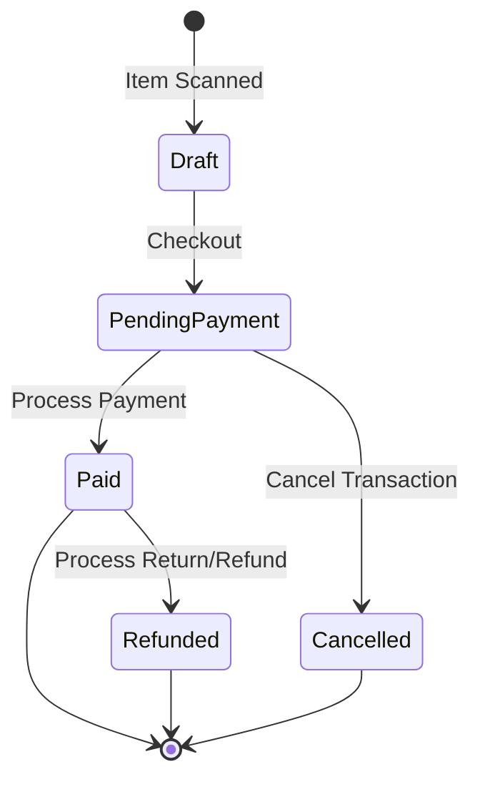

# 29. Sales Domain

## 1. Business Purpose
The Sales module manages customer POS transaction checkouts, shifts, and cash drawer reconciliations. It records sales revenue, handles card/cash payments, and deducts sold items from stock inventory.
- **Target Users**: Cashiers, Outlet Supervisors, Business Owner.

---

## 2. Master Data Dependencies
The following master data entities must exist for Sales operations:
- **User**: Cashiers opening/closing shifts.
- **Product & Product Variant**: Stock items available for sale.
- **Outlet**: Physical retail sales store location.

---

## 3. Core Entities
- **Shift**: Shift ID, Cashier ID, Outlet ID, Open Time, Close Time, Opening Cash Balances, Expected Cash Balances, Actual Counted Cash Balances, Discrepancy Amount, Status (Open/Closed).
- **POS Sales Order**: Invoice Number, Shift ID, Customer Name (optional), Total Item Count, Subtotal, Discount, Tax, Grand Total, Payment Status (Paid/Unpaid/Refunded), Cashier ID, Order Date.
  - **Sales Order Item**: Product ID, Quantity, Unit Price, Subtotal.
- **POS Payment**: Payment ID, Invoice Number, Payment Method (Cash, Credit Card, QRIS, Bank Transfer), Amount Paid, Transaction Reference Number, Payment Date.

---

## 4. Entity Relationships
- **Shift** 1 ── * contains many * ──> **POS Sales Order**
- **POS Sales Order** 1 ── * contains many * ──> **POS Payment**
- **POS Sales Order** 1 ── * has many * ──> **Sales Order Item**

---

## 5. Status Lifecycle & State Machine

### Allowed Transitions:
- `Draft` -> `PendingPayment` (Cashier presses checkout)
- `PendingPayment` -> `Paid` (Cash payment accepted / Card terminal confirms)
- `PendingPayment` -> `Cancelled` (Cashier voids order before payment)
- `Paid` -> `Refunded` (Supervisor approves customer return)

### Forbidden Transitions:
- `Draft` -> `Paid` (Cannot record paid status without processing payment)
- `Refunded` -> `Paid` (Cannot reverse a refunded invoice)

---

## 6. Business Rules
1. **Active Shift Requirement**: Cashiers cannot record transactions without having an active `Open` shift.
2. **Drawer Lock**: Opening cash balances must be entered manually and verified before the shift is marked as `Open`.
3. **Discrepancy Reporting**: Cash differences during close-shift checks must be logged automatically as a ledger discrepancy.

---

## 7. Validation Rules
- **Quantities**: Must be positive integers.
- **Pricing**: POS prices must match active master prices. Discounts cannot exceed the order total.
- **Payment Matching**: Total payment transactions amount must equal the invoice Grand Total.

---

## 8. Approval Workflow
- **Transaction Voids**: Voiding an item or cancelling a transaction after checkout has started requires Outlet Supervisor authorization.
- **Refunds**: All refunds must be approved by the Outlet Supervisor.

---

## 9. Domain Events
- `ShiftOpened`: Fired when a cashier starts a shift.
- `SalesOrderPaid`: Fired when payment is confirmed (triggers receipt printing).
- `SalesOrderRefunded`: Fired when an invoice is returned/refunded.
- `ShiftClosed`: Fired when cashier reconciles drawer balances.

---

## 10. Numbering Convention
- **POS Sales Order (Invoice)**: `INV-YYYYMMDD-XXXXXX` (e.g. `INV-20260715-000123`)

---

## 11. Permission Matrix
- `sales.shift.open` -> `KASIR`, `SUPERVISOR_OUTLET`, `OWNER`
- `sales.checkout.create` -> `KASIR`, `SUPERVISOR_OUTLET`, `OWNER`
- `sales.checkout.void` -> `SUPERVISOR_OUTLET`, `OWNER`
- `sales.refund.approve` -> `SUPERVISOR_OUTLET`, `OWNER`

---

## 12. UI Screen Layout Blueprint
- **Header**: Active Shift info (Cashier, Outlet), open orders count, logout/shift actions.
- **POS Interface Grid**:
  - **Left Section**: Product selection grid categorized by types (Bread, Cakes, Pastries) with fast search.
  - **Right Section**: Active Cart layout showing item details, total tax, and checkout buttons.
- **Form Dialog (Payment Drawer)**: Pop-up overlay offering Payment Methods (Cash, Card, QRIS) with exact change calculator.
- **Receipt Dialog**: Printable receipt preview.
- **Comments**: void reasons or order notes.

---

## 13. Typical API Blueprint
- `POST /api/v1/sales/shifts/open` (Open shift)
- `POST /api/v1/sales/checkout` (Submit cart for invoice creation)
- `POST /api/v1/sales/checkout/:invoiceNo/pay` (Record payment transaction details)
- `POST /api/v1/sales/checkout/:invoiceNo/void` (Void order)
- `POST /api/v1/sales/shifts/:id/close` (Close shift and reconcile cash)

---

## 14. Reports
- **Daily Sales Summary**: Total revenue by payment method.
- **Top Product Yield**: Product sales volume rankings.
- **Drawer Discrepancy Logs**: Summary of cash discrepancies by cashier.

---

## 15. Integration Points & Notifications
- **Inventory module**: Decreases finished goods inventory upon `SalesOrderPaid`.
- **Finance module**: Records cash receipts and card receivables in the ledgers upon invoice completion.
- **Notifications**: Discord/Telegram alert to owner if a shift closes with a cash discrepancy > $20.

---

## 16. Future Extension
- **Customer Loyalty System**: Point collection and reward coupon redemptions.
- **Digital Receipts**: Direct email receipt dispatches.
