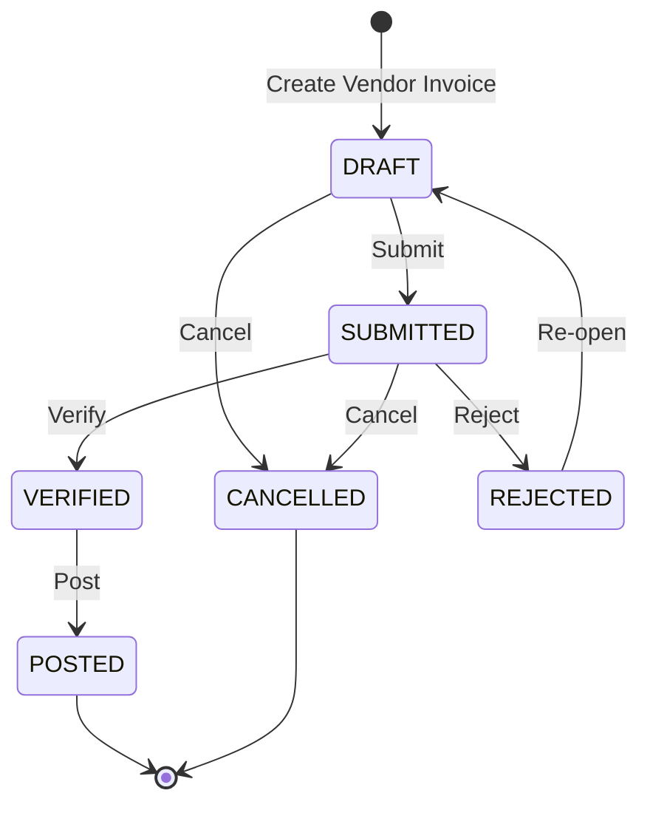

# 30. Finance Domain

## 1. Business Purpose
The Finance module oversees payables, receivables, ledger postings, expenses, and financial reporting. It receives commercial source documents from Procurement and Sales, then turns them into controlled financial obligations and accounting records.

- **Target Users**: Finance Admin, Outlet Supervisors, Business Owner.

---

## 2. Master Data Dependencies
The following master data entities must exist for Finance operations:

- **User**: For bookkeeping inputs, audit, verification, and posting.
- **Vendor / Supplier**: To map Vendor Invoices and future Accounts Payable.
- **Payment Term**: To calculate Vendor Invoice and Accounts Payable due dates consistently.
- **Outlet**: Financial reporting segmented by location.

---

## 3. Core Entities
- **Vendor Invoice**: Internal ERP invoice number, Supplier ID, Outlet ID, Purchase Order ID, Payment Term ID, supplier invoice/reference number, invoice date, due date, line items, subtotal, discount, tax, grand total, and status (`DRAFT`, `SUBMITTED`, `VERIFIED`, `REJECTED`, `CANCELLED`, `POSTED`).
- **Expense Log**: Expense ID, Location ID, Category (Rent, Utilities, Wages, Petty Cash), Amount, Expense Date, Payee Name, Payment Method, Status (Pending/Approved/Rejected).
- **Account Payable (AP) / Account Receivable (AR)**: Ledger obligation ID, Entity Type (Vendor/Customer), Entity ID, Payment Term Snapshot, Original Amount, Paid Amount, Outstanding Amount, Due Date, Status (`OPEN`, `PARTIALLY_PAID`, `PAID`, `CANCELLED`).
- **General Ledger Transaction**: GL ID, Transaction Date, Reference Type (Invoice, Expense, POS Sale), Reference ID, Total Debit, Total Credit, Status (Posted).
  - **Ledger Journal Entry**: Account Code (Chart of Accounts), Debit Amount, Credit Amount.

---

## 4. Entity Relationships
Payment Term is referenced by Vendor Invoice and Account Payable for due date calculation and AP aging preparation. Purchase Order `estimatedPaymentDueDate` is not the authoritative Accounts Payable due date; Vendor Invoice must calculate its own due date from invoice/business date and the snapshotted payment-term policy.

- **Purchase Order** (Procurement) 1 -> many **Goods Receipts** -> **Vendor Invoice**.
- MVP Vendor Invoice cardinality is 1 Supplier + 1 Outlet + 1 Purchase Order + multiple Goods Receipts from that Purchase Order.
- **Vendor Invoice** 1 -> 1 **Account Payable** obligation after financial posting.
- **General Ledger Transaction** 1 -> many **Ledger Journal Entries**.

---

## 5. Vendor Invoice Status Lifecycle

Allowed transitions:

- `DRAFT` -> `SUBMITTED`
- `DRAFT` -> `CANCELLED`
- `SUBMITTED` -> `VERIFIED`
- `SUBMITTED` -> `REJECTED`
- `SUBMITTED` -> `CANCELLED`
- `REJECTED` -> `DRAFT`
- `VERIFIED` -> `POSTED`

Forbidden transitions:

- `POSTED` -> `CANCELLED`; posted financial documents must be reversed through an approved correction flow.
- `POSTED` -> `DRAFT`.
- `PAID`, `PARTIALLY_PAID`, and `OVERDUE` are Accounts Payable/payment conditions, not `VendorInvoiceStatus`.

---

## 6. Business Rules
1. **Double Entry Rule**: Debit must equal credit for every General Ledger transaction.
2. **Locked Periods**: Past financial periods that are marked as `Closed` must block new postings or modifications.
3. **Petty Cash Limits**: Daily petty cash expenses cannot exceed approved outlet limits without Owner authorization.
4. **Vendor Invoice Source of Truth**: Billable quantity must derive from successfully posted accepted `InventoryMovement` records, minus finalized Purchase Return quantity and previously invoiced quantity. Purchase Order ordered quantity alone is not billable quantity.
5. **Billable Reservation**: `DRAFT` does not reserve billable quantity. `SUBMITTED` and `VERIFIED` reserve billable quantity. `POSTED` finalizes invoiced quantity. `REJECTED` and `CANCELLED` release reservation.
6. **Payment Term Required**: Vendor Invoice must use Payment Term master data. Cash/COD invoices use a Payment Term with `dueDays = 0`.
7. **Supplier Invoice Identity**: Supplier Vendor Invoice Number is normalized with `trim + uppercase`, unique per Supplier, and permanently reserved even when the ERP Vendor Invoice is soft-deleted.
8. **Accounts Payable Boundary**: `POSTED` Vendor Invoice is not the same as `PAID`. Payment, outstanding amount, AP aging, and overdue conditions belong to Accounts Payable.
9. **Three-Way Matching Boundary**: Vendor Invoice matching is separate from `VendorInvoiceStatus`. Matching compares Purchase Order, posted Goods Receipt purchase movements, posted Purchase Return return movements, and Vendor Invoice line quantities/prices before financial posting.
10. **Three-Way Matching Result**: Matching status is `NOT_EVALUATED`, `MATCHED`, or `EXCEPTION`. A current matching result is persisted for Finance review, while previous current results are invalidated when invoice/source reservation data changes.
11. **Three-Way Matching Tolerance MVP**: Quantity, unit price, and pre-tax subtotal matching use zero tolerance. Tax matching and advanced rounding tolerance are out of scope until a finance/tax policy is approved.
12. **Vendor Invoice Verification Gate**: `SUBMITTED -> VERIFIED` must run a fresh authoritative three-way match. `MATCHED` is required for verification. `EXCEPTION` remains a valid matching result but blocks verification until resolved.
13. **Vendor Invoice Posting Boundary**: `VERIFIED -> POSTED` must run a fresh authoritative three-way match and create exactly one Accounts Payable obligation in the same transaction. A Vendor Invoice must never become `POSTED` without AP creation.
14. **AP Identity MVP**: Accounts Payable is a ledger obligation in MVP and does not use a separate `AP-YYYY-XXXXXX` document number. Traceability uses the AP ID plus Vendor Invoice internal and external invoice numbers.
15. **AP Overdue**: `OVERDUE` is derived from due date and outstanding amount; it is not persisted as AP lifecycle status. Only `OPEN` and `PARTIALLY_PAID` obligations with `outstandingAmount > 0` may be overdue.
16. **AP Aging MVP**: Accounts Payable aging bucket is derived, not persisted. Active outstanding obligations use `CURRENT`, `1_30_DAYS`, `31_60_DAYS`, `61_90_DAYS`, and `OVER_90_DAYS`; `PAID`, `CANCELLED`, or zero-outstanding records return no aging bucket.
17. **AP Read-Only MVP**: Accounts Payable is read-only until a payment settlement issue is approved.

---

## 7. Validation Rules
- **Tax Calculations**: Net amount, discount, tax, and grand total must be calculated by backend using Decimal-safe arithmetic.
- **Dates**: Invoice date is the business invoice date. Due date is authoritative and equals `invoiceDate + paymentTermDueDays`.
- **Currency**: MVP uses the configured system/base currency, currently `IDR`. Multi-currency conversion is out of scope.
- **Duplicate Supplier Invoice**: `supplierId + normalizedVendorInvoiceNumber` must remain unique permanently, including soft-deleted documents.

---

## 8. Verification and Posting
- **Vendor Invoices**: Verification uses the `finance.vendor-invoice.verify` permission.
- **Posting**: Posting uses the `finance.vendor-invoice.post` permission, requires a fresh `MATCHED` three-way match, creates one Accounts Payable obligation atomically, and then marks Vendor Invoice as `POSTED`.
- **Settlement**: Payment settlement is out of scope for Vendor Invoice and belongs to Accounts Payable.

---

## 9. Domain Events
- `VendorInvoiceSubmitted`: Fired when a vendor invoice is submitted.
- `VendorInvoiceVerified`: Fired when a vendor invoice is verified.
- `VendorInvoicePosted`: Fired when a vendor invoice is posted.
- `JournalPosted`: Fired when a GL transaction is finalized.
- `ExpenseCreated`: Fired when expenses are submitted.
- `PaymentSent`: Fired when payments are cleared.

---

## 10. Numbering Convention
- **Vendor Invoice**: `VINV-YYYY-XXXXXX` (e.g. `VINV-2026-000001`)
- **Expense Log**: `EXP-YYYY-XXXXXX` (e.g. `EXP-2026-000001`)
- **Journal Transaction**: `GL-YYYY-XXXXXX` (e.g. `GL-2026-000001`)

---

## 11. Permission Matrix
- `finance.vendor-invoice.read` -> `OWNER`, `FINANCE_ADMIN`
- `finance.vendor-invoice.create` -> `OWNER`, `FINANCE_ADMIN`
- `finance.vendor-invoice.update` -> `OWNER`, `FINANCE_ADMIN`
- `finance.vendor-invoice.verify` -> `OWNER`, `FINANCE_ADMIN`
- `finance.vendor-invoice.post` -> `OWNER`, `FINANCE_ADMIN`
- `finance.vendor-invoice.manage` -> `OWNER`
- `finance.expense.create` -> `OWNER`, `SUPERVISOR_OUTLET`
- `finance.journal.view` -> `OWNER`, `FINANCE_ADMIN`

---

## 12. UI Screen Layout Blueprint
- **Header**: Financial document status, workflow actions, and document identity.
- **Filters**: Vendor, status, date range, outlet.
- **Data Table**: Displays document number, supplier invoice number, supplier, invoice date, due date, totals, and status.
- **Document Detail**: Card-based layout with source documents, payment information, invoice items, financial summary, comments, attachments, and activity history.
- **Approval Timeline**: Traces verification and posting history.
- **Attachments**: PDF invoices, receipts, bills, or bank statement imports.
- **Comments**: Audit trail descriptions.

---

## 13. Typical API Blueprint
- `POST /api/v1/vendor-invoices` (Create vendor invoice)
- `POST /api/v1/finance/expenses` (Log business expense)
- `POST /api/v1/finance/journals` (Post journal entries)
- `GET /api/v1/finance/reports/cashflow` (Retrieve cashflow report data)

---

## 14. Reports
- **Balance Sheet**: Financial assets, liabilities, and equity.
- **Profit & Loss (P&L)**: Revenue against operating costs.
- **Cashflow Statement**: Cash inflows and outflows tracking.
- **AP Aging**: Future report derived from Accounts Payable due dates and outstanding balances, not Vendor Invoice lifecycle status.

---

## 15. Integration Points & Notifications
- **Procurement module**: Provides Purchase Order, Goods Receipt, Purchase Return, and posted inventory movement source data for Vendor Invoice.
- **Accounts Payable**: Future module created after Vendor Invoice posting.
- **Sales POS module**: Auto-posts daily shift receipts to sales revenue.
- **Notifications**: Automated alert sent to Owner when an AP obligation is overdue.

---

## 16. Future Extension
- **Three-Way Matching**: Compare Purchase Order, Goods Receipt, Purchase Return, and Vendor Invoice.
- **Accounts Payable**: Manage outstanding balances, payment allocation, AP aging, and payment status.
- **Bank Feeds Integration**: Automated bank statement reconciliations.
- **Tax Filing Integration**: Automatic exports formatted for quarterly tax filings.
