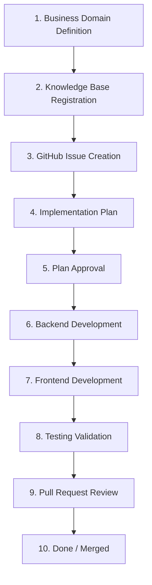

# 32. Module Development Workflow

This document establishes the mandatory lifecycle for development of all ERP modules. Under no circumstances may any development step be skipped.

---

## The Workflow Lifecycle

---

## Workflow Steps Detail

### Step 1: Business Domain Definition
- **Objective**: Freeze requirements, core entities, states, workflows, and business rules.
- **Output**: Detailed Business Analysis. No code may be written in this stage.

### Step 2: Knowledge Base Registration
- **Objective**: Formally register domain documents under the `knowledge-base/` directory (e.g. `26.procurement-domain.md`).
- **Output**: Merged Knowledge Base document detailing all specifications.

### Step 3: GitHub Issue Creation
- **Objective**: Map requirements into the Sprint backlog using the GitHub Automation tool.
- **Output**: Provisioned GitHub Project board items containing stable IDs.

### Step 4: Implementation Plan
- **Objective**: Create `implementation_plan.md` artifact outlining Objective, Database changes, API changes, UI changes, Files to create, and Verification steps.
- **Output**: Detailed `implementation_plan.md` markdown file in the artifact directory.

### Step 5: Plan Approval
- **Objective**: Review the plan with the Project Lead Architect and USER.
- **Output**: Explicit approval feedback in the conversation transcript before coding begins.

### Step 6: Backend Development
- **Objective**: Build the backend foundations in NestJS:
  1. Prisma database schema updates and migrations.
  2. DTO and Zod/Class-Validator validations.
  3. Repositories and Data access layer.
  4. Core Business Services (all business logic).
  5. Controller routes and Swagger specs.
- **Output**: Stable, compiled backend service.

### Step 7: Frontend Development
- **Objective**: Build the Next.js presentation layers:
  1. TypeScript Interfaces and type mappings.
  2. Zod validation schemas.
  3. Frontend client Services.
  4. React Query hooks and Form components.
  5. Page layout composings.
- **Output**: Frontend interface matching the ERP UI Foundation guidelines.

### Step 8: Testing Validation
- **Objective**: Run all required test sweeps.
  - Backend: Unit tests and API integrations tests.
  - Frontend: Type check validation (`npx tsc --noEmit`) and UI functionality check.
- **Output**: Zero errors on compiler, linter, and testing suites.

### Step 9: Pull Request Review
- **Objective**: Open a Pull Request detailing the changes, test results, and self-review checklists.
- **Output**: Code review approval from senior peers/architects.

### Step 10: Done
- **Objective**: Merge the branch into the main development branch.
- **Output**: Closed GitHub Issues and updated local cache file.
