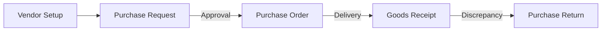
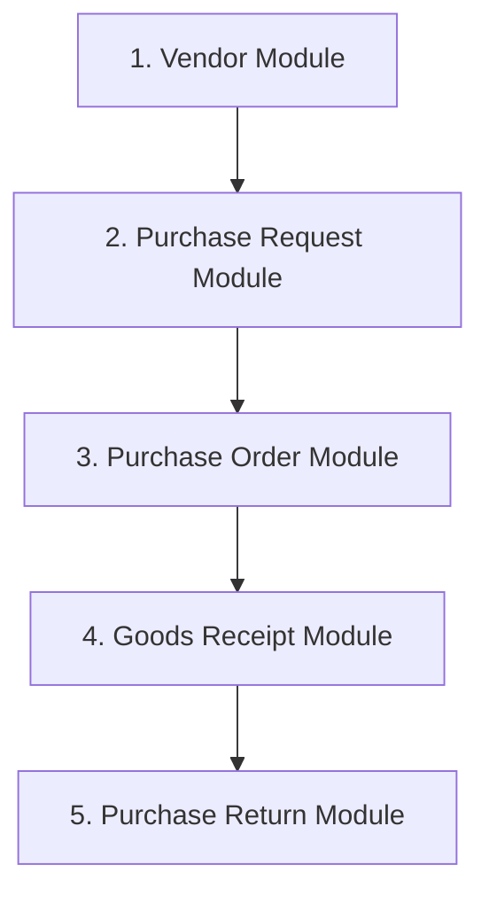

# 33. Procurement Foundation

This document defines the operational architecture, entity relationships, dependencies, and development sequence for the Procurement module.

---

## 1. Operational Flow Sequence

The procurement lifecycle operates in a linear sequence:

1. **Vendor**: Must be registered and approved before any purchasing transaction starts.
2. **Purchase Request (PR)**: Initiated by outlets needing replenishment.
3. **Purchase Order (PO)**: Generated based on approved PR details and sent to the vendor.
4. **Goods Receipt (GR)**: Logged by outlet staff upon shipment arrival.
5. **Purchase Return**: Triggered if items are damaged, expired, or incorrect upon GR inspection.

---

## 2. Entity Links & Foreign Keys
- `PurchaseRequest.locationId` references `Outlet.id`
- `PurchaseRequestLineItem.productId` references `Product.id`
- `PurchaseOrder.purchaseRequestId` references `PurchaseRequest.id` (required for Sprint 2 MVP)
- `PurchaseOrder.supplierId` references `Supplier.id` (Business/UI term: Vendor)
- `GoodsReceipt.purchaseOrderId` references `PurchaseOrder.id`
- `GoodsReceiptItem.productId` references `Product.id`
- `PurchaseReturn.goodsReceiptId` references `GoodsReceipt.id`

---

## 3. Module Sequence & Development Order

To prevent dependencies bottlenecks, components must be developed in the following order:

### Development Phases for each Module:
1. **Prisma Database Schema**: Update `prisma.schema` and run migrations.
2. **Backend Foundation**: Repositories, DTOs, Zod/Class-validator schemas, and Services.
3. **Backend API Route Controllers**: API endpoints exposed with Swagger specification.
4. **Backend Integration Tests**: Unit and integration tests.
5. **Frontend Client Services & Hooks**: Axios/Fetch wrappers and React Query configurations.
6. **Frontend UI Components**: Form dialogs, tables, filter bars, and header UI layouts.
